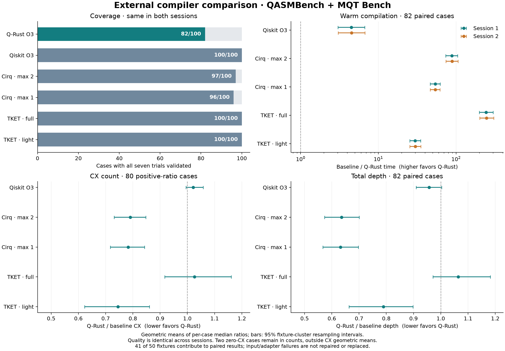

# External community benchmark comparison

The 2026-10-18 UTC run compares **50 externally sourced circuits, 100 circuit–topology cases, six recipes and two sessions of seven trials**. Q-Rust completed **82/100 cases**. On those 82 cases, its warm compilation time was 4.49–4.52× faster than Qiskit, 88.32–89.13× faster than the primary Cirq recipe, and 243.15–247.50× faster than the primary TKET recipe, using geometric means of paired median runtimes. These are **conditional comparisons of specific recipes**, with substantial exceptions and input-compatibility gaps.

Every successfully emitted circuit passed the independent numerical checks. The study found unsupported input syntax in Q-Rust and an output-canonicalization defect in the Cirq adapter. Those failures remain in the frozen record. No compiler or adapter was repaired, tuned or substituted after viewing these external results.

## Coverage and correctness

The following counts are identical in both sessions. A successful case requires all seven prescribed trials to compile and pass validation.

| Recipe | Successful cases / 100 | Passed timed outputs / 700 | Error outputs / 700 |
|---|---:|---:|---:|
| Q-Rust O3 | 82 | 574 | 126 |
| Qiskit O3 | 100 | 700 | 0 |
| Cirq, maximum two synthesis iterations | 97 | 679 | 21 |
| Cirq, maximum one synthesis iteration | 96 | 672 | 28 |
| TKET, full peephole recipe | 100 | 700 | 0 |
| TKET, lighter synthesis recipe | 100 | 700 | 0 |

Across both sessions, **8,050 of 8,400 timed requests produced accepted outputs; 350 produced errors, and none timed out**. There were 605 distinct source/target/output/layout artifacts: 408 checked over every basis input and 197 checked on eight inputs. Repeated artifacts reuse checksum-bound numerical evidence. All 4,025 successful same-seed output pairs were identical across sessions, as were the 175 corresponding error outcomes. Warmups separately retained 1,150 passing outputs and 50 errors, with no worker restarts.

The independent analytic NumPy checker uses one shared global phase, full physical amplitudes, explicit input/output mappings, and a residual threshold of `1e-7`. It also checks basis closure and connectivity. It checks every input basis state through six physical qubits and eight inputs above six. Maximum observed residuals were `2.50e-13` for Q-Rust, `2.76e-12` for Qiskit, `1.05e-11` for primary Cirq, and `4.53e-9` for primary TKET. These are numerical acceptance results, not formal proofs; the larger-circuit checks are sampled.

**Q-Rust's failure is input vocabulary.** All 18 failed cases contain `cu1`: MQT AE at 5/10 qubits, exact and inexact QPE at 5/10, MQT quantum walk at 5, and QASMBench PEA at 5 and QFT at 4, each on both targets. The public parser reports `Unknown gate: cu1` before optimization. Q-Rust accepted 32/34 QASMBench fixtures and 9/16 MQT fixtures. The shared frontend already expands CRZ/RZZ but leaves CU1 in the input; this exposes a frontend compatibility gap and limits what the paired results cover. In particular, this run supplies **no Q-Rust performance result for the external QFT or phase-estimation fixtures**.

**Cirq's failures are in this adapter, not evidence of SDK inability.** The QASM importer can represent `cu1(pi)` as a controlled `QasmUGate` whose matrix equals CZ. Cirq's target synthesis accepts that representation. Our CZ-to-CX conversion recognizes only `CZPowGate`, so it leaves the equivalent controlled gate behind and the strict serializer rejects it. A supplemental minimal probe reproduced this and confirmed exact matrix equality to CZ. Primary Cirq fails on exact-QPE-10 on both targets and exact-QPE-5 all-to-all; the lighter recipe also fails on exact-QPE-5 line. These are all within Q-Rust's unsupported subset, so both profile comparisons use the same 82 successful cases. The diagnosis and reproducer are retained in the evidence archive.

## Speed, conditional on the same 82 successful cases

Ratios below are **baseline time / Q-Rust time**; above one favors Q-Rust. Brackets are 95% fixture-cluster bootstrap intervals, preserving the two targets of each fixture. The point estimate weights each successful case equally. These intervals describe resampling stability of this selected corpus, not a representative population of quantum applications.

| Baseline recipe | Session 1 compile ratio [95% interval] | Session 2 compile ratio [95% interval] | Full request ratio, sessions 1 / 2 |
|---|---:|---:|---:|
| Qiskit O3 | 4.49 [3.03, 6.68] | 4.52 [3.04, 6.72] | 4.12 / 4.13 |
| Cirq, max 2 | 88.32 [73.62, 104.81] | 89.13 [74.16, 105.95] | 82.03 / 82.63 |
| Cirq, max 1 | 54.03 [46.52, 62.40] | 53.95 [46.42, 62.29] | 54.18 / 53.92 |
| TKET, full | 243.15 [198.94, 299.63] | 247.50 [202.20, 305.76] | 188.10 / 190.83 |
| TKET, light | 29.64 [25.33, 34.96] | 29.85 [25.45, 35.26] | 25.42 / 25.56 |

Compilation excludes parsing, startup/imports, serialization, IPC and checking. Full request time includes the worker request/response overhead and parsing/serialization, but still excludes process startup. Neither is a cold command-line invocation. Lighter Cirq/TKET helpers include their small stage-clock/dictionary bookkeeping; no estimated overhead is subtracted.

Absolute times help interpret the ratios. These are **medians across the same 82 case medians**, in milliseconds; dividing these medians does not reconstruct the paired geometric means.

| Recipe | Compile ms, session 1 / 2 |
|---|---:|
| Q-Rust | 0.416 / 0.406 |
| Qiskit | 2.555 / 2.570 |
| Cirq, max 2 | 43.511 / 43.700 |
| Cirq, max 1 | 30.940 / 30.334 |
| TKET, full | 134.875 / 138.329 |
| TKET, light | 14.688 / 14.511 |

Q-Rust was faster than Qiskit on 69/82 cases in session 1, but slower on 13. On SAT-11 line, Q-Rust took **72.28 ms versus Qiskit's 13.88 ms**; session 2 repeated the approximately 5.2× disadvantage. Q-Rust produced fewer CX gates there, 510 versus 526, and lower depth, 534 versus 640. That is a speed–quality trade-off, not a uniform speed win.

The Qiskit speed ratio drops from approximately 6.8× at widths 2–6 to 1.76× at widths 7–10 and 1.34–1.37× at widths 11–14. The last group contains only three fixtures/six cases. The data do not establish large-circuit scaling. The full suite/width/topology breakdowns and a family-balanced sensitivity summary are in the machine-readable results.

## Structural output quality

All outputs use arbitrary U3/CX gates with free, recorded initial/final logical permutations. Ratios below are **Q-Rust cost / baseline cost**; below one favors Q-Rust. Output artifacts and quality results were identical across sessions. CX count and CX-depth geometric means use 80 positive-ratio cases; two zero-CX cases remain in the win/tie/loss and near-best counts. Total-depth ratios use all 82 paired cases.

| Baseline recipe | CX ratio [95% interval] | Total-depth ratio [95% interval] | CX-depth ratio |
|---|---:|---:|---:|
| Qiskit O3 | 1.021 [0.995, 1.059] | 0.957 [0.910, 1.003] | 1.018 |
| Cirq, max 2 | 0.790 [0.731, 0.848] | 0.635 [0.573, 0.700] | 0.757 |
| Cirq, max 1 | 0.783 [0.717, 0.843] | 0.632 [0.567, 0.698] | 0.757 |
| TKET, full | 1.026 [0.917, 1.161] | 1.064 [0.972, 1.182] | 1.052 |
| TKET, light | 0.745 [0.623, 0.861] | 0.790 [0.663, 0.898] | 0.761 |

Close aggregate ratios to Qiskit and full TKET coexist with large individual gaps. They do not show that Q-Rust is uniformly close to either tool. Primary TKET beats Q-Rust's CX count on 15 cases, ties 50 and loses 17; Qiskit beats Q-Rust on 11, ties 64 and loses 7.

| Illustrative case | Q-Rust CX / depth | Qiskit CX / depth | Primary Cirq CX / depth | Full TKET CX / depth |
|---|---:|---:|---:|---:|
| Error-correction-d3, 5 qubits, all-to-all | 47 / 76 | 35 / 64 | 35 / 69 | **9 / 13** |
| Basis-test, 4 qubits, all-to-all | 10 / 13 | 6 / 9 | 20 / 29 | **5 / 7** |
| W-state, 3 qubits, line | **10 / 17** | 10 / 19 | 13 / 27 | 12 / 19 |
| SAT, 11 qubits, line | **510 / 534** | 526 / 640 | 670 / 1087 | 618 / 649 |

On all-to-all targets, Q-Rust's CX geometric mean is 1.14× full TKET's; on line targets it is 0.926×. Its corresponding total-depth ratios are 1.13× and approximately 1.00×. Thus even the direction of an aggregate CX comparison depends on topology.

Against the **best observed primary baseline median** per case, Q-Rust is at least as good on 62/82 CX counts and 55/82 depths. It is within 5% on **65/82 CX counts (79.3%)** and **59/82 depths (72.0%)**; within 10% on 68/82 and 65/82, respectively. Counting the full selected denominator, 65/100 cases produced a validated Q-Rust output within 5% of the best primary baseline CX count, while 18/100 had no Q-Rust output. These are percentages of cases meeting an empirical threshold, **not percentages of optimality**.

## What the recipe changes establish

The same sessions directly compare two prespecified effort changes. These comparisons use each baseline's own success intersection, so their denominators differ from the Q-Rust tables.

| Intervention | Paired cases | Primary / light compile time, sessions 1 / 2 | Light / primary CX | Light / primary total depth |
|---|---:|---:|---:|---:|
| Cirq: max 2 → max 1 synthesis iterations | 96 | 1.662 / 1.678 | 1.012 | 1.006 |
| TKET: FullPeepholeOptimise → SynthesiseTket initially | 100 | 8.375 / 8.438 | 1.364 | 1.318 |

Cirq's extra iteration spends substantial time for a small aggregate quality improvement here. TKET's richer initial optimization has a much larger quality effect. On error-correction-d3 all-to-all, replacing full peephole optimization with the lighter initial synthesis changes TKET from 9 CX/depth 13 to 49 CX/depth 77. This isolates the effect of the **recipe change**, not which individual internal rewrite caused it. Against the lighter baseline set, Q-Rust is within 10% of the observed best on 75/82 CX counts and depths; that is a different reference set and cannot replace the primary result.

Source inspection also establishes structural differences: Q-Rust's bounded two-wire blocks stop at third-wire interactions and accept only strict CX reductions; TKET's full peephole pass includes two- and three-qubit resynthesis; Qiskit's pinned preset uses an iterative peephole loop with broader tie-breaks; Cirq synthesizes through full CZ and then converts to CX. These mechanisms are described in [the recipe audit](EXTERNAL_COMPILER_RECIPES.md). Explaining every individual gap would require matched ablations or pass traces. Runtime differences cannot be attributed to Rust alone: the algorithms and work budgets differ, and Qiskit/TKET also use native compiled components.

## Why this corpus is useful, and its limits

[QASMBench](https://doi.org/10.1145/3550488) supplies external OpenQASM routines from several application areas; [MQT Bench](https://doi.org/10.22331/q-2023-07-20-1062) supplies configurable algorithm-level circuits. [Benchpress](https://www.nature.com/articles/s43588-025-00792-y) is a methodological reference for software workload, target and cost comparisons. These are community benchmark resources, not a certification standard. This run does not execute the full Benchpress suite or reproduce its score/settings.

The fixed inventory contains 150 entries. Scope rules first exclude 84 entries (upstream-transpiled variants, widths above 14, or raw size above 250 KB); of 66 remaining candidates, 16 fail static-unitary/parse/gate-cap eligibility. The final corpus contains 34 QASMBench and 16 MQT fixtures, 2–14 qubits and 4–1,506 expanded source gates. The 100 inventory exclusions are not compiler failures. Of the 50 selected fixtures, 35 have at most six qubits, 12 have 7–10, and only three exceed ten. Thirty-eight family labels include related variants and do not mean 38 independent applications.

Selection preceded compiler outcomes. The frontend removes only barriers and a global terminal-measurement suffix, excludes dynamic circuits, and expands source/Qiskit gate definitions without running an optimization pass manager. Accessing definitions can itself invoke Qiskit's decomposition or synthesis. Original-to-common-input checks all passed before timing. This is a **common static gate representation track**, with an explicit Qiskit frontend dependency; it does not test each SDK's best native high-level path or full measured application behavior.

The study is more informative than the earlier hand-maintained fixtures because it exposes previously missed compatibility failures and substantial adverse cases. Its claims remain bounded by the selected inputs, 82-case success intersection, ideal bidirectional line/all-to-all targets, one Apple M3 host with 8 GiB RAM, and fixed recipes with unequal search effort. Gate counts and unit-duration depth do not measure hardware fidelity, execution duration, memory footprint or universal SDK quality. Two repeated sessions and fixture-cluster intervals do not remove selection bias.

The concrete compatibility work exposed here is to support or exactly lower CU1 at the public input boundary and canonicalize equivalent controlled-CZ output in the Cirq adapter, each with regression tests. A corrected comparison must be a separately identified follow-up; these frozen failures must not be replaced with successful reruns. Optimization investigations should separately address the error-correction/basis-test synthesis gaps and the SAT/HHL runtime tails. Any tuning on these cases turns them into development cases for subsequent evaluations.

## Evidence and reproduction

- [Methods, pinned sources, licenses and reproduction commands](EXTERNAL_BENCHMARK_METHODS.md)
- [Exact recipes, numerical policies and trade-offs](EXTERNAL_COMPILER_RECIPES.md)
- [Structured summaries and intervals](external_results/20261018/summary.json)
- [Independent absolute-time, subgroup and full-request audit](external_results/20261018/audit_detail.json)
- [Session 1 primary cells](external_results/20261018/session_1_primary_cells.csv) and [lighter cells](external_results/20261018/session_1_light_cells.csv)
- [Session 2 primary cells](external_results/20261018/session_2_primary_cells.csv) and [lighter cells](external_results/20261018/session_2_light_cells.csv)
- [Compressed original evidence](external_results/20261018/evidence.tar.gz), [file/checksum manifest](external_results/20261018/evidence_manifest.json), and [successful archive replay receipt](external_results/20261018/archive_reanalysis_receipt.json)

Q-Rust compiler source: `dbc4645f3183b2d44dc076f431b98932510c9a20`. Executable SHA256: `004ca5c49481ef7eed018bb33686ee0e8f27e6504758ba0b0d804783ee90d047`. The harness/corpus code was committed before timing at `8f72d86`. SDK versions are Qiskit 2.5.2, Cirq 1.7.0 and pytket 2.18.5. The 152 Python regression tests passed before the official freeze. Independent postflight checks verified raw-grid/hash integrity and 1,006 point-summary/subgroup assertions; bootstrap intervals use the frozen, regression-tested analyzer and were not independently recalculated.
