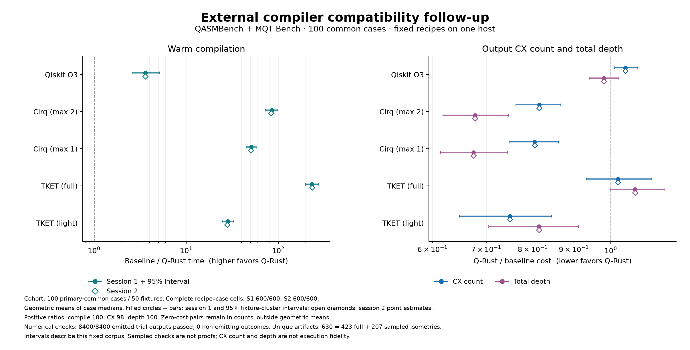

# External benchmark compatibility follow-up

Q-Rust CU1 support and the Cirq adapter closure defect are fixed. All six recipes now compile and pass numerical validation on all **100 circuit-target cases** in both sessions: **8,400 measured outputs passed, with no errors or timeouts**. The [original study](EXTERNAL_BENCHMARKS.md), including its failures, is preserved byte-for-byte.

On the original 82 shared cases, every previously successful output and layout is unchanged. Q-Rust’s geometric mean compile-time ratio relative to its previous run is 0.9969 in session 1 and 1.0016 in session 2. The follow-up therefore restores compatibility without an observed output-quality regression on those cases. These timing repetitions do not isolate a causal effect of the code change.

Across the full 100-case corpus, Q-Rust retains a substantial aggregate speed advantage under the specified recipes, with mixed output-quality trade-offs. The newly supported controlled-phase workloads are weaker against Qiskit than the old supported subset.

## Coverage and correctness

| Recipe | Original complete cases | Follow-up complete cases | Passed measured outputs, both sessions |
| --- | ---: | ---: | ---: |
| Q-Rust O3 | 82/100 | 100/100 | 1,400/1,400 |
| Qiskit O3 | 100/100 | 100/100 | 1,400/1,400 |
| Cirq, max 2 iterations | 97/100 | 100/100 | 1,400/1,400 |
| Cirq, max 1 iteration | 96/100 | 100/100 | 1,400/1,400 |
| TKET, full | 100/100 | 100/100 | 1,400/1,400 |
| TKET, light | 100/100 | 100/100 | 1,400/1,400 |

The 630 distinct measured artifacts comprise 423 full numerical isometries and 207 sampled isometries. The maximum residual is 4.53e-9 against a 1e-7 threshold. All 1,200 warmups also pass by exact artifact matches to validated measured outputs; no worker restarts occurred. Every same-seed artifact and layout agrees between sessions (4,200 pairs). Every previously emitted artifact agrees with its follow-up counterpart (8,050 before/after pairs across both sessions). These counts reuse cached checks for identical source/output/layout combinations; they are not 8,400 independent circuits.

## Speed and output cost on all 100 cases

Entries are geometric means of paired case medians. Speed is baseline time divided by Q-Rust time, so larger favors Q-Rust. Output-cost ratios are Q-Rust divided by baseline, so smaller favors Q-Rust. Compilation and depth use 100 cases; CX count and CX depth use 98 positive-cost pairs, with two all-zero cases retained in counts but excluded from geometric means. Quality point estimates are identical between the two sessions.

| Baseline recipe | Compile speedup S1 / S2 | CX ratio | Total-depth ratio | CX-depth ratio |
| --- | ---: | ---: | ---: | ---: |
| Qiskit O3 | 3.61× / 3.60× | 1.0433 | 0.9809 | 1.0386 |
| Cirq, max 2 synthesis iterations | 84.98× / 84.13× | 0.8150 | 0.6780 | 0.8015 |
| TKET, full peephole | 232.16× / 233.31× | 1.0206 | 1.0728 | 1.0389 |
| Cirq, max 1 synthesis iteration | 50.83× / 50.36× | 0.8042 | 0.6745 | 0.8007 |
| TKET, lighter synthesis | 28.32× / 27.86× | 0.7485 | 0.8141 | 0.7703 |

Against Qiskit, the aggregate corresponds to 4.3% more CX gates and 1.9% less total depth. Against full TKET it corresponds to 2.1% more CX gates and 7.3% more total depth. Against the specified Cirq recipe Q-Rust produces fewer CX gates and shallower outputs. These aggregate trade-offs are not universal dominance: Q-Rust is faster than Qiskit on 82/100 case medians in each session, and faster than the other four recipes on all 100.

Full-request speedups, including parsing, serialization and communication, are 3.42×/3.41× versus Qiskit, 79.23×/78.79× versus primary Cirq, 184.43×/186.03× versus full TKET, 50.82×/50.58× versus lighter Cirq and 24.75×/24.44× versus lighter TKET. Imports and process startup remain outside this warm-worker request boundary. Q-Rust’s median of the 100 case-median compile times is 0.485/0.482 ms; its corresponding full-request medians are 0.615/0.612 ms. These medians are distinct from the paired geometric ratios above.

Session-1 95% fixture-cluster bootstrap intervals are shown below; all session-2 intervals and topology/width strata remain in the compact summary; full family strata remain in the evidence archive. These intervals describe variation within this fixed corpus, not a representative random sample of applications.

| Baseline recipe | Compile-speedup interval | CX-ratio interval | Total-depth-ratio interval |
| --- | ---: | ---: | ---: |
| Qiskit O3 | 2.576–5.121 | 1.011–1.080 | 0.940–1.024 |
| Cirq, max 2 synthesis iterations | 72.618–99.212 | 0.762–0.865 | 0.618–0.746 |
| TKET, full peephole | 196.314–276.022 | 0.932–1.123 | 0.997–1.168 |
| Cirq, max 1 synthesis iteration | 44.751–57.531 | 0.747–0.861 | 0.613–0.743 |
| TKET, lighter synthesis | 24.544–32.859 | 0.648–0.843 | 0.705–0.912 |

Q-Rust is within 10% of the best primary recipe on 74/100 cases for CX count, 70/100 for total depth and 76/100 for CX depth. “Best” means the best observed recipe median, not a proven optimum. Lighter recipes change the reference set: Cirq’s primary recipe takes about 1.67× its lighter runtime for a 1.3% geometric CX reduction; full TKET takes 8.20–8.37× its lighter runtime for a 26.7% geometric CX reduction. This sensitivity is why these speed ratios must be attached to the named recipes.



## Separating coverage from before/after changes

The original 82-case cohort remains fixed. Its CX counts, CX depths and total depths are unchanged for every previously successful recipe/trial. The new speed ratios on this cohort are 4.44×/4.43× versus Qiskit, 88.39×/87.49× versus primary Cirq, and 244.60×/245.91× versus full TKET. Q-Rust’s own before/after compile ratios are within 0.4% of unity. Unchanged Qiskit and full TKET timings on the same 82 cases vary by roughly 0.3–2.0% across corresponding runs; these are descriptive drift checks, not a correction model.

The 18 newly common cases represent nine fixtures: MQT AE at 5/10 qubits, exact and inexact QPE at 5/10 qubits, MQT quantum walk at 5 qubits, QASMBench PEA at 5 qubits and QFT at 4 qubits, each on both graphs. They had no valid Q-Rust output in the original study, so no Q-Rust before/after quality improvement can be calculated.

| Newly supported 18-case cohort | Compile speedup S1 / S2 | CX ratio | Total-depth ratio | CX-depth ratio |
| --- | ---: | ---: | ---: | ---: |
| Qiskit O3 | 1.41× / 1.40× | 1.1474 | 1.0962 | 1.1357 |
| Cirq, max 2 synthesis iterations | 71.01× / 70.39× | 0.9335 | 0.9110 | 1.0310 |
| TKET, full peephole | 183.00× / 183.61× | 0.9968 | 1.1137 | 0.9836 |

On those new cases, Q-Rust has only a 1.40–1.41× geometric compile advantage over Qiskit, with 14.7% more CX gates and 9.6% more total depth. The session-1 speedup interval is 0.796–2.481, so this small cohort does not support a consistent speed advantage. The full-corpus 3.6× figure must not be compared directly with the original 4.5× figure as a code regression; their case composition differs.

Concrete session-1 medians show the remaining weaknesses. Each cell below is **compile milliseconds / CX count / total depth**. All outputs passed the stated numerical check.

| Circuit and target | Q-Rust | Qiskit | Cirq primary | TKET full |
| --- | ---: | ---: | ---: | ---: |
| MQT AE-10, line | 25.61 / 217 / 249 | 7.34 / 173 / 176 | 841.51 / 286 / 315 | 1671.01 / 273 / 221 |
| MQT exact QPE-10, line | 24.25 / 239 / 270 | 7.48 / 192 / 166 | 664.63 / 206 / 222 | 1085.91 / 259 / 193 |
| MQT inexact QPE-10, line | 26.99 / 274 / 273 | 7.22 / 173 / 176 | 704.75 / 228 / 263 | 1142.20 / 279 / 218 |
| MQT quantum walk-5, line | 71.80 / 612 / 747 | 14.79 / 583 / 770 | 2647.47 / 701 / 1123 | 3865.74 / 710 / 852 |
| QASMBench QFT-4, line | 0.67 / 17 / 29 | 2.93 / 17 / 29 | 65.00 / 19 / 29 | 118.37 / 21 / 29 |
| QASMBench error_correctiond3-5, all-to-all | 0.94 / 47 / 76 | 2.55 / 35 / 64 | 95.32 / 35 / 69 | 267.78 / 9 / 13 |

The QPE line results show that repaired gate support does not solve routing and synthesis trade-offs: Q-Rust can be slower than Qiskit and emit more CX gates and greater depth, while still compiling faster than Cirq/TKET. The error-correction case retains a large TKET quality advantage. This follow-up changes compatibility only and does not isolate which pass causes each remaining gap; the original recipe audit describes the mechanisms but is not a complete causal attribution.

## Changes and regression evidence

Q-Rust now recognizes the OpenQASM `cu1(theta)` primitive as its own two-qubit gate. Its action is `diag(1,1,1,exp(i*theta))`. The implementation uses two CX gates and three exact phase rotations. For computational-basis bits a,b, the accumulated phase is `theta/2 * (a - (a XOR b) + b) = theta*a*b`. This preserves the phase on the control branch that would be lost by treating CU1 as CRZ. Parser names, arity/parameter validation, decomposition, serialization and diagonal classification agree on the new primitive. No routing, placement or block-synthesis algorithm was changed.

Seven Rust regression tests cover analytic matrices and decomposition, symbolic angles, negative and large angles, reversed operands, custom gate bodies, register broadcasting, malformed/nonfinite inputs, serialization, full turns, and every input basis state across optimization levels and connectivity graphs. The circuit oracle is independent of Q-Rust's simulator and shares one phase across all input columns. All seven tests failed against the previous implementation and pass with the fix.

The Cirq QASM importer can represent a full controlled phase as a controlled QasmUGate rather than a CZPowGate. Cirq accepts that equivalent operation in its CZ target set, so the prior class-only adapter missed it and rejected the correct compiled output during serialization. The corrected adapter recognizes a two-qubit unitary equal to full CZ up to one global phase, then lowers it by Hadamard–CX–Hadamard conjugation. Ordinary CX and typed CZ retain fast paths. Fractional or other two-qubit operations outside the target fail closed. The absolute matrix tolerance is 1e-10 with zero relative tolerance; the typed exponent check uses 1e-10/pi. Recognition, lowering and resulting one-qubit fusion remain inside the compilation timer.

Seven added Python regression tests exercise semantic CZ import, global and input-dependent phases, both operand orders, fractional angles, tolerance boundaries, unchanged native CX, both Cirq recipes and both target topologies. The full Rust suite, formatting and lint checks passed; the complete Python suite including the new follow-up analysis regressions passed 165 tests. A separate 36-request synthetic worker/adapter preflight passed full-input checks across all six recipes and both graphs, with maximum residual 1.06e-14. An independent audit found no blocking issue in either fix.

## Follow-up protocol

This is a separately recorded compatibility follow-up to [the original external study](EXTERNAL_BENCHMARKS.md). The original report and evidence remain unchanged. The exact original manifest contains 50 fixtures from QASMBench and MQT Bench; both all-to-all and line targets produce 100 circuit-target cases. No fixture was added, removed, regenerated or normalized differently.

The six recipes, SDK versions, seeds, schedules, seven timed trials, one initial warmup, two sequential sessions, timeout, thread caps and validation oracle are unchanged. The compiler source is frozen at `7c18b686a8fbbeafe01eb1f96ce6b6f6a3989699`; the executable SHA256 is `3b9df4b86bd3a9c270776ce791720952e46feb12fbb8458ebacbf693679d4b77`. The new protocol SHA256 is `b13989a0801244d4f595eb91708e469c1158eeed41307ab29ba5ec2f9ee29f84`. The source audit permits exactly three production Rust files, one new Rust regression file, and the Cirq adapter to differ in the frozen compiler/harness hashes.

Timing uses the same Apple M3 host and persistent sequential workers. No builds or simulations overlap the timing sessions. Compilation time includes cloning, configuration, compiler passes and compiled-circuit retrieval; parsing is separate. Full request time additionally includes serialization and communication. Ordinary operating-system activity and CPU frequency remain uncontrolled. The two sessions are analyzed separately, and all failures or timeouts remain in their recorded denominators.

Validation runs only after both timing sessions. It uses the unchanged independent analytic NumPy oracle, legality checks, complete physical amplitudes and one shared global phase. Through six physical qubits it checks every basis input; at larger widths it checks eight prescribed inputs. The tolerance remains 1e-7. These are numerical equivalence checks, with finite input sampling at larger widths, not a proof of compiler correctness.

The before/after comparison fixes the original 82 common successful cases using only the original study. It reports the newly common cohort and full follow-up cohort separately. Comparing a new 100-case aggregate directly with an old 82-case aggregate would confound coverage with performance. Same-case, same-recipe and same-seed output changes are retained explicitly. Unchanged Qiskit/TKET recipes provide descriptive timing-drift controls; no adjustment or causal attribution is inferred from them.

These external cases have now informed compatibility repairs and are regression/development evidence, not an unseen holdout. CX count, CX depth and total U3/CX depth measure circuit cost on ideal graphs, not physical fidelity or certified optimality. The fixed recipes have unequal search effort. Language choice is not isolated by this experiment. The original [methods](EXTERNAL_BENCHMARK_METHODS.md), [recipe audit](EXTERNAL_COMPILER_RECIPES.md) and source limitations still apply, except for the explicitly repaired CU1 support and Cirq closure behavior described here.

## Retained evidence and reproduction

- [Compact results, intervals and before/after comparisons](external_results/20261018_compatibility/summary.json).
- [Session 1 primary cells](external_results/20261018_compatibility/session_1_primary_cells.csv) and [session 2 primary cells](external_results/20261018_compatibility/session_2_primary_cells.csv); lighter-profile tables are in the same directory.
- [Numerical validation receipt](external_results/20261018_compatibility/validation_summary.json).
- [Follow-up evidence archive](external_results/20261018_compatibility/evidence.tar.gz) and [checksums](external_results/20261018_compatibility/evidence_manifest.json).
- [Original evidence archive](external_results/20261018/evidence.tar.gz), retained unchanged and required for cross-run reanalysis.
- [Archive replay receipt](external_results/20261018_compatibility/archive_reanalysis_receipt.json).

The archive contains the exact protocol, measured/warmup/validated rows, full analysis JSON and four tables, cross-run analysis, frozen harness and audit receipts. Original upstream source bytes and licenses remain in the original archive, linked by its SHA256. Extract into new directories. The archive README gives commands for replaying the follow-up analysis and cross-run comparison; both are verified against the retained outputs. For a new measured reproduction, use the unchanged methods with the fixed compiler commit above and a new output directory. Do not overwrite either recorded study.

After normal external validation and analysis, the before/after comparison is generated with:

```sh
python experiments/analyze_external_followup.py ORIGINAL_STUDY FOLLOWUP_STUDY \
  --output NEW_COMPARISON_DIRECTORY
```
