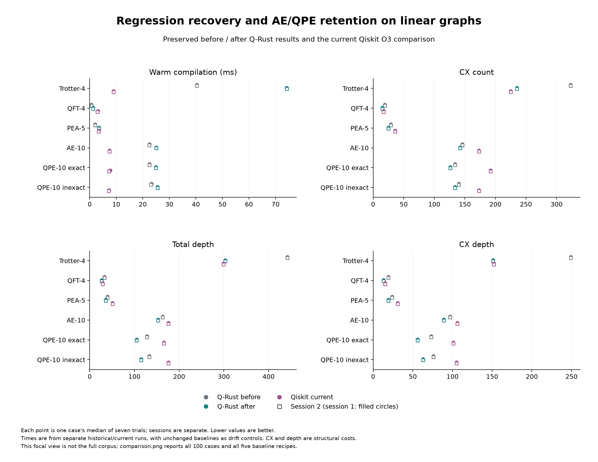
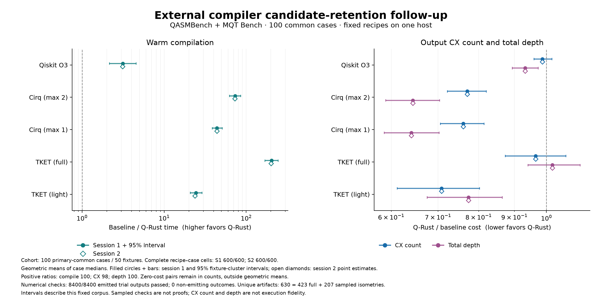

# External routing candidate-retention follow-up

Bounded candidate retention recovers the Trotter-4, QFT-4 and PEA-5 line regressions while preserving and further improving the AE/QPE output gains. Trotter returns to 235 CX; QFT reaches 15 and PEA 25, below their earlier 17 and 27. AE, exact QPE and inexact QPE reach 142, 126 and 134 CX, with lower total and CX-only depths. No case in the unchanged 100-case corpus regresses on any of these three selection metrics relative to the immediately preceding routing study.

Evaluating alternatives adds compilation work. The full-corpus Q-Rust after/before compile-time geometric ratios are **1.1675 and 1.1696** for the two sessions: **16.75% / 16.96% slower**. AE/QPE line compilation is about 10–12% slower than the immediately preceding routing study. Output-quality gains are retained, but the earlier timing gains are not fully retained. The tables retain the timing costs separately from output-quality gains. The three previous studies and all 43 prior report/result files remain unchanged.

## Focal results

Each time is a median of seven trials; S1 and S2 remain separate. Structural metrics agree between sessions. “Before” means the preserved routing study, which already contains the AE/QPE improvements. The older compatibility reference sets recovery ceilings of 235/303/151 for Trotter, 17/29/15 for QFT, and 27/37/20 for PEA (CX/total depth/CX depth). All 12 focal circuit/topology cells meet their predeclared ceilings in every trial.

| Line case | Compile ms before, S1 / S2 | Compile ms after, S1 / S2 | CX before → after | Depth before → after | CX depth before → after |
|---|---:|---:|---:|---:|---:|
| Trotter-4 | 40.342 / 40.312 | 74.193 / 74.266 | 323 → 235 | 442 → 303 | 249 → 151 |
| QFT-4 | 0.635 / 0.706 | 1.322 / 1.319 | 19 → 15 | 33 → 27 | 19 → 13 |
| PEA-5 | 2.022 / 2.013 | 3.479 / 3.482 | 29 → 25 | 40 → 36 | 24 → 19 |
| AE-10 | 22.552 / 22.458 | 25.045 / 25.061 | 146 → 142 | 163 → 153 | 97 → 89 |
| QPE-10 exact | 22.566 / 22.557 | 24.902 / 24.894 | 134 → 126 | 128 → 105 | 73 → 56 |
| QPE-10 inexact | 23.271 / 23.144 | 25.580 / 25.579 | 140 → 134 | 133 → 115 | 76 → 63 |



On complete graphs, the focal outputs retain their previous CX/depth/CX-depth values: Trotter 199/267/133, QFT 12/21/10, PEA 17/31/15, AE 90/97/48, exact QPE 85/83/41 and inexact QPE 90/97/48. Extra evaluation can still have a time cost even when the chosen output is unchanged.

Current comparisons below use session 1 medians; the archive and CSV tables retain session 2, every trial and dispersion. These are fixed SDK recipes with different optimization effort, not each tool's universally best configuration.

| Line case | Recipe | Compile ms | CX | Total depth | CX depth |
|---|---|---:|---:|---:|---:|
| Trotter-4 | Q-Rust O3 | 74.193 | 235 | 303 | 151 |
| Trotter-4 | Qiskit O3 | 8.947 | 225 | 299 | 152 |
| Trotter-4 | Cirq max two | 2168.875 | 682 | 923 | 461 |
| Trotter-4 | Cirq max one | 1345.972 | 780 | 1037 | 518 |
| Trotter-4 | TKET full | 2742.102 | 324 | 317 | 214 |
| Trotter-4 | TKET light | 748.956 | 582 | 736 | 408 |
| QFT-4 | Q-Rust O3 | 1.322 | 15 | 27 | 13 |
| QFT-4 | Qiskit O3 | 3.056 | 17 | 29 | 15 |
| QFT-4 | Cirq max two | 65.065 | 19 | 29 | 14 |
| QFT-4 | Cirq max one | 36.327 | 19 | 29 | 14 |
| QFT-4 | TKET full | 119.953 | 21 | 29 | 19 |
| QFT-4 | TKET light | 17.479 | 21 | 29 | 19 |
| PEA-5 | Q-Rust O3 | 3.479 | 25 | 36 | 19 |
| PEA-5 | Qiskit O3 | 3.460 | 36 | 51 | 31 |
| PEA-5 | Cirq max two | 120.629 | 32 | 55 | 27 |
| PEA-5 | Cirq max one | 74.640 | 38 | 49 | 24 |
| PEA-5 | TKET full | 233.844 | 38 | 48 | 33 |
| PEA-5 | TKET light | 42.665 | 69 | 103 | 64 |
| AE-10 | Q-Rust O3 | 25.045 | 142 | 153 | 89 |
| AE-10 | Qiskit O3 | 7.438 | 173 | 176 | 106 |
| AE-10 | Cirq max two | 844.495 | 286 | 315 | 157 |
| AE-10 | Cirq max one | 452.838 | 288 | 313 | 156 |
| AE-10 | TKET full | 1687.779 | 273 | 221 | 172 |
| AE-10 | TKET light | 148.671 | 390 | 252 | 202 |
| QPE-10 exact | Q-Rust O3 | 24.902 | 126 | 105 | 56 |
| QPE-10 exact | Qiskit O3 | 7.705 | 192 | 166 | 101 |
| QPE-10 exact | Cirq max two | 670.208 | 206 | 222 | 111 |
| QPE-10 exact | Cirq max one | 360.732 | 220 | 222 | 111 |
| QPE-10 exact | TKET full | 1093.026 | 259 | 193 | 155 |
| QPE-10 exact | TKET light | 770.537 | 347 | 210 | 168 |
| QPE-10 inexact | Q-Rust O3 | 25.580 | 134 | 115 | 63 |
| QPE-10 inexact | Qiskit O3 | 7.235 | 173 | 176 | 105 |
| QPE-10 inexact | Cirq max two | 702.394 | 228 | 263 | 131 |
| QPE-10 inexact | Cirq max one | 378.071 | 232 | 267 | 133 |
| QPE-10 inexact | TKET full | 1159.962 | 279 | 218 | 174 |
| QPE-10 inexact | TKET light | 780.548 | 318 | 190 | 148 |

## What changed and why

The regressions share an objective mismatch: routing primarily minimizes SWAP cost, while final CX count and depth depend on the order and boundaries presented to cancellation and two-qubit resynthesis. Equal SWAP cost does not imply equal lowered quality. The earlier CU1 classification, logical-SWAP absorption and layout memoization remain enabled.

Trotter's original two-wire interactions are already adjacent on the line. Absorbing interior logical SWAPs changed local block boundaries, then routing reintroduced the same number of SWAPs in a different order. The previous causal study recorded 54 emitted SWAPs in both paths: retained logical SWAPs versus routing-inserted SWAPs and 564 CX before cleanup, but markedly different block-synthesis savings. A sufficient structural certificate now retains the original sequence as one alternative when every two-wire interaction is adjacent under identity placement and a nonterminal SWAP exists. That branch disables logical-SWAP absorption and nested candidate generation. It is not restricted by circuit name, width or source hash.

QFT has equally cheap completed routes with different cleanup opportunities. The router now preserves one representative with the smallest raw circuit depth among equal-SWAP completions encountered along the original forward/backward search trajectory. The canonical first completion still drives reverse refinement; trying another output does not redirect the existing search.

PEA additionally exposes the difference between the greedy layout score and beam routing. An already examined placement estimated at seven SWAPs routes in six under one forward beam search, and lowers to 25 CX at depth 36. The policy considers at most one distinct refined placement whose greedy score is within one SWAP of the actual winning route. This window bounds effort; the greedy score is not a lower bound, and better excluded placements can exist.

All alternatives undergo the same lowering, cleanup, direction repair, target-basis closure and structural/hardware checks. Each keeps its own initial/final maps and a copy of the numerical budget already spent by the shared optimization prefix. Rejected alternatives cannot spend the selected branch's allowance. Terminal readout is restored through each candidate's final map before comparison.

Selection uses the original canonical output as a fixed reference. A candidate must not increase two-qubit count, total depth or two-qubit depth. Among eligible candidates, the ordering is two-qubit count first, then total depth, then two-qubit depth; exact ties retain the earlier output. A moving reference would incorrectly reject PEA's 25-CX/depth-36 candidate after first selecting a 29-CX/depth-32 candidate, even though both improve the canonical 29/40 output. A dedicated regression covers that interaction. The objective counts two-qubit gates in the resolved basis, including CZ, rather than depending on CX spelling.

The portfolio is bounded to the canonical output plus at most two routing alternatives and one retained local-input sequence. Routing alternatives are suppressed across barrier-segmented routing, where a segment's placement affects later segments. The local certificate is sufficient rather than exhaustive. The new `retain_routing_candidates` configuration switch disables the policy for matched comparisons. No numerical threshold, approximation allowance or SDK recipe changes.

## Controlled diagnostics

Six exact-source controls cover the 12 focal cases, each with one warmup and seven interleaved trials. Profiling and complete-column numerical checks run after these diagnostic timings. `disabled` turns off the candidate policy and reproduces the preserved compiler's outputs and maps. The three `no_*` controls remove one candidate opportunity while retaining the rest; equal-SWAP and refined-layout controls still incur their candidate-generation work. These diagnose mechanisms on development cases and do not replace the two official sessions.

| Line case | Policy control | Compile ms | CX | Total depth | CX depth |
|---|---|---:|---:|---:|---:|
| Trotter-4 | preserved_baseline | 39.873 | 323 | 442 | 249 |
| Trotter-4 | disabled | 40.318 | 323 | 442 | 249 |
| Trotter-4 | no_equal_swap | 57.017 | 235 | 303 | 151 |
| Trotter-4 | no_refined_layout | 74.221 | 235 | 303 | 151 |
| Trotter-4 | no_local_sequence | 59.761 | 323 | 442 | 249 |
| Trotter-4 | full | 74.267 | 235 | 303 | 151 |
| QFT-4 | preserved_baseline | 0.613 | 19 | 33 | 19 |
| QFT-4 | disabled | 0.629 | 19 | 33 | 19 |
| QFT-4 | no_equal_swap | 1.000 | 17 | 28 | 15 |
| QFT-4 | no_refined_layout | 0.973 | 15 | 27 | 13 |
| QFT-4 | no_local_sequence | 1.293 | 15 | 27 | 13 |
| QFT-4 | full | 1.293 | 15 | 27 | 13 |
| PEA-5 | preserved_baseline | 1.985 | 29 | 40 | 24 |
| PEA-5 | disabled | 2.021 | 29 | 40 | 24 |
| PEA-5 | no_equal_swap | 2.827 | 25 | 36 | 19 |
| PEA-5 | no_refined_layout | 2.741 | 29 | 32 | 19 |
| PEA-5 | no_local_sequence | 3.456 | 25 | 36 | 19 |
| PEA-5 | full | 3.444 | 25 | 36 | 19 |
| AE-10 | preserved_baseline | 22.348 | 146 | 163 | 97 |
| AE-10 | disabled | 22.445 | 146 | 163 | 97 |
| AE-10 | no_equal_swap | 22.642 | 146 | 163 | 97 |
| AE-10 | no_refined_layout | 25.005 | 142 | 153 | 89 |
| AE-10 | no_local_sequence | 24.916 | 142 | 153 | 89 |
| AE-10 | full | 24.931 | 142 | 153 | 89 |
| QPE-10 exact | preserved_baseline | 22.528 | 134 | 128 | 73 |
| QPE-10 exact | disabled | 22.532 | 134 | 128 | 73 |
| QPE-10 exact | no_equal_swap | 22.663 | 134 | 128 | 73 |
| QPE-10 exact | no_refined_layout | 24.813 | 126 | 105 | 56 |
| QPE-10 exact | no_local_sequence | 24.713 | 126 | 105 | 56 |
| QPE-10 exact | full | 24.700 | 126 | 105 | 56 |
| QPE-10 inexact | preserved_baseline | 23.168 | 140 | 133 | 76 |
| QPE-10 inexact | disabled | 23.181 | 140 | 133 | 76 |
| QPE-10 inexact | no_equal_swap | 23.301 | 140 | 133 | 76 |
| QPE-10 inexact | no_refined_layout | 25.545 | 134 | 115 | 63 |
| QPE-10 inexact | no_local_sequence | 25.429 | 134 | 115 | 63 |
| QPE-10 inexact | full | 25.506 | 134 | 115 | 63 |

Every diagnostic artifact passes complete-input numerical checking, with one phase shared across all basis columns. Candidate generation and final selection remain heuristics: this study does not show globally optimal or near-optimal circuits. More candidate lowerings can reduce output cost while increasing compilation time.

## Full-corpus comparison

All 100 predeclared cases remain eligible under all six recipes. Zero-CX pairs remain in coverage counts and are excluded only from positive-ratio geometric means. Full-case results include all timing increases and any total-gate-count regressions; total single-qubit gate count is not part of the three-metric selection guard.

| Q-Rust metric | Improved cases | Unchanged | Regressed | After / before geometric ratio |
|---|---:|---:|---:|---:|
| CX count | 16 | 84 | 0 | 0.97826 |
| Total depth | 16 | 84 | 0 | 0.97483 |
| CX depth | 16 | 84 | 0 | 0.96769 |
| Total gates | 12 | 85 | 3 | 0.99280 |

The total-gate increases are one gate each on the line: exact QPE-10 313 → 314, exact QPE-5 70 → 71, and inexact QPE-5 71 → 72. These are retained adverse results even though the three selected output metrics do not worsen.

The request-wall after/before ratios are 1.1486 / 1.1509. Unchanged baseline recipes have compile-time ratios ranging from 0.9810 to 1.0202 across the sessions; these are descriptive drift controls, not a correction for machine variation. The exact-source diagnostic comparisons provide separate evidence about policy costs.

The following ratios use geometric means of paired case medians: speedup is baseline time / Q-Rust time, and output cost is Q-Rust / baseline. Larger speedups and smaller output ratios favor Q-Rust.

| Baseline recipe | Compile speedup S1 / S2 | CX ratio | Total-depth ratio | CX-depth ratio |
|---|---:|---:|---:|---:|
| Qiskit O3 | 3.127 / 3.122 | 0.9866 | 0.9319 | 0.9743 |
| Cirq max two | 73.078 / 72.562 | 0.7706 | 0.6442 | 0.7519 |
| Cirq max one | 44.086 / 43.798 | 0.7604 | 0.6409 | 0.7511 |
| TKET full | 203.391 / 201.014 | 0.9651 | 1.0192 | 0.9746 |
| TKET light | 24.454 / 23.737 | 0.7078 | 0.7735 | 0.7226 |



The figure reports 95% fixture-cluster intervals from 2,000 bootstrap resamples, keeping the complete/line versions of a fixture together. Sessions are separate and primary/light views reuse Q-Rust and Qiskit observations. These intervals describe this fixed corpus, not all quantum circuits. Depth is an ASAP layer count with unit gate costs, not measured hardware duration; CX count and depth do not measure execution fidelity.

## Correctness and experimental contract

The full suite passes 436 Rust tests and 185 Python tests, formatting, and strict Clippy. New tests exercise the local SWAP mechanism, procedural QFT/PEA fixtures, independent analytic evolution on every input column, fixed-reference selection, branch-local numerical budgets, canonical routing identity, bounded candidate metadata, barriers, directed edges, spare physical wires, terminal measurement destinations and report/plain compilation parity.

All 8,400 timed outputs and 1,200 warmups pass the unchanged numerical, basis and coupling checks. The 630 unique timed artifacts comprise 423 full and 207 sampled numerical isometries; maximum residual 4.531e-09. All 4,200 same-seed session pairs and all 7,000 non-Q-Rust before/after pairs retain identical outputs and mappings.

The ordinary benchmark oracle remains unchanged: every basis input through six physical qubits and eight prescribed inputs above six, all physical amplitudes, and one shared global phase with tolerance `1e-7`. Supplemental checks cover all columns for every one of the 12 focal timed Q-Rust artifacts, including all 1,024 columns for each ten-qubit case, and bind them to all 168 focal timed rows. Their largest input residual is 2.503e-13. Before timing, all 92 candidate checks passed: 12 focal cases plus 80 fresh synthetic circuit/topology cases, maximum residual 2.503e-13. Complete-column checks remain numerical evidence, not formal implementation proofs; unrelated large benchmark outputs remain sampled.

The study uses the same 50 community fixtures (34 QASMBench, 16 MQT Bench), 100 complete/line target cases, six recipes, schedules, seeds, seven trials, two sessions, one warmup per recipe/case/session, common U/CX basis, mapping allowance, approximation thresholds and 11 frozen harness files. Only five compiler modules and one integration-test file change in compiler provenance. Source commit: `837a53ca9a9d4ca3f25cab3e5866b170e582c4a4`. All non-Q-Rust output artifacts and mappings are checked against the preserved study.

SDK versions remain Qiskit 2.5.2, Cirq 1.7.0 and pytket 2.18.5, on the same Apple M3, 8 GiB, macOS 14.4.1 / Python 3.12 environment. Persistent workers use identical single-thread caps and interleaved recipes. Both sessions finish before validation, analysis or any concurrent agent builds/tests/simulations. Ordinary OS activity and CPU frequency/affinity remain uncontrolled. Warm compile time includes cloning, configuration, passes and output retrieval; parse time is separate, and process startup/imports, serialization, IPC and independent numerical checking are outside that timer. Internal structural, basis and hardware checks performed by compilation remain inside the timer. Request-wall time is retained as a broader boundary.

The benchmark contract allows free initial/final logical permutations to every compiler and checks emitted circuits with those maps. Fixed physical I/O would require a separate experiment accounting for permutation restoration. The corrected corpus has informed implementation and is a development/regression corpus, not an untouched generalization holdout. These comparisons do not isolate a Rust language effect or explain every difference with other compiler recipes.

## Preserved evidence and reproduction

The [original study](EXTERNAL_BENCHMARKS.md), [compatibility study](EXTERNAL_COMPATIBILITY_FOLLOWUP.md) and [routing study](EXTERNAL_ROUTING_FOLLOWUP.md) remain byte-identical. New results are recorded only in [`external_results/20261018_retention`](external_results/20261018_retention), with preservation checks for all 43 prior files.

- [Summary](external_results/20261018_retention/summary.json), [validation](external_results/20261018_retention/validation_summary.json), and [figure definitions](external_results/20261018_retention/FIGURE_NOTES.md).
- [Evidence archive](external_results/20261018_retention/evidence.tar.gz), [manifest](external_results/20261018_retention/evidence_manifest.json), and [replay receipt](external_results/20261018_retention/archive_reanalysis_receipt.json).
- [Comparison analyzer](analyze_external_retention.py), [analyzer regressions](test_analyze_external_retention.py), and [renderer](render_external_retention.py).

The archive retains protocols, raw/warmup/validated rows, full analyses, policy controls, supplemental checks, changed sources/tests and independent audit utilities. It binds all three older archives by hash. Safe extraction of all four archives supports replay of the full analysis, four CSV tables and before/after comparison without recompilation; six outputs are compared byte-for-byte.

```sh
cargo build --locked --release -p qrust-bench --bin comparison_runner
python experiments/external_comparison.py prepare /path/to/corpus/manifest.json /new/study \
  --binary target/release/comparison_runner --compiler-commit 837a53ca9a9d4ca3f25cab3e5866b170e582c4a4 \
  --trials 7 --sessions 2 --timeout 60 --seed 20261018
python experiments/external_comparison.py time /new/study --binary target/release/comparison_runner --session 1
python experiments/external_comparison.py time /new/study --binary target/release/comparison_runner --session 2
python experiments/external_comparison.py validate /new/study
python experiments/analyze_external_comparison.py /new/study
python experiments/analyze_external_retention.py /preserved/routing/study /new/study \
  --plan /extracted/receipts/investigation_plan.json --output /new/comparison
```

Use a new destination for every rerun; retain historical results and adverse outcomes.
