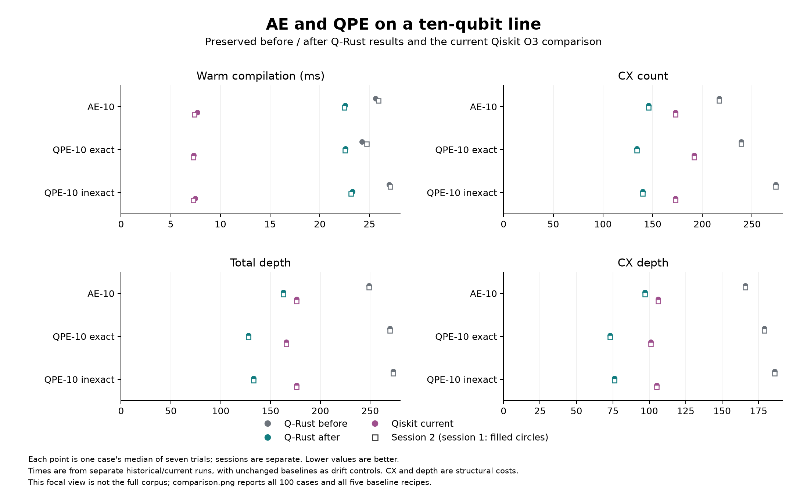
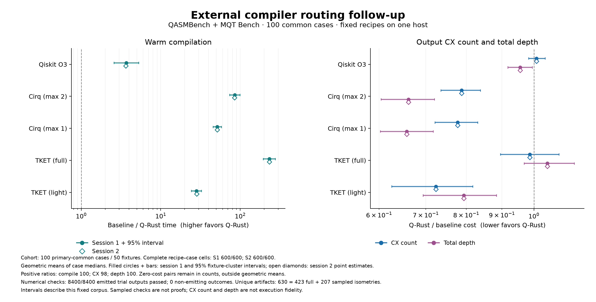

# External routing follow-up: AE-10 and QPE-10

The controlled-phase and logical-SWAP fixes substantially reduce CX count and depth on the three targeted ten-qubit line cases. Compilation is 7–15% faster than the preserved Q-Rust baseline in the two timing sessions, but remains about three times slower than Qiskit O3 on these cases. Their output costs are now below every tested baseline recipe on these three cases. This is a trade-off between compilation time and circuit cost, not a general compiler ranking.

The complete 100-case rerun also finds three output-quality regressions, including a substantial Trotter-circuit regression. Across the full corpus, the geometric compile-time change is less than 1%, within the variation seen in unchanged baseline recipes. The main measured improvement is output quality on the targeted workloads. Both previous studies remain unchanged; this is a separate result record.

## Targeted results

Each time below is the median of seven trials in one session. S1 and S2 are separate repetitions; counts and depths agree across both. Depth is an ASAP layer count with unit gate costs, not a hardware execution duration.

| Ten-qubit line case | Compile ms before, S1 / S2 | Compile ms after, S1 / S2 | CX before → after | Depth before → after | CX depth before → after |
|---|---:|---:|---:|---:|---:|
| AE-10 | 25.614 / 25.927 | 22.552 / 22.458 | 217 → 146 | 249 → 163 | 166 → 97 |
| QPE-10 exact | 24.248 / 24.713 | 22.566 / 22.557 | 239 → 134 | 270 → 128 | 179 → 73 |
| QPE-10 inexact | 26.994 / 27.108 | 23.271 / 23.144 | 274 → 140 | 273 → 133 | 186 → 76 |



Current comparison, session 1 medians; session 2 values and every individual trial are retained in the linked data. The Qiskit trial seeds vary; the other recipes report deterministic compilation, so their repetitions primarily measure timing variation.

| Case | Recipe | Compile ms | CX | Depth | CX depth |
|---|---|---:|---:|---:|---:|
| AE-10 | Q-Rust O3 | 22.552 | 146 | 163 | 97 |
| AE-10 | Qiskit O3 | 7.666 | 173 | 176 | 106 |
| AE-10 | Cirq, max two iterations | 850.297 | 286 | 315 | 157 |
| AE-10 | Cirq, max one iteration | 448.598 | 288 | 313 | 156 |
| AE-10 | TKET full | 1679.469 | 273 | 221 | 172 |
| AE-10 | TKET light | 147.118 | 390 | 252 | 202 |
| QPE-10 exact | Q-Rust O3 | 22.566 | 134 | 128 | 73 |
| QPE-10 exact | Qiskit O3 | 7.312 | 192 | 166 | 101 |
| QPE-10 exact | Cirq, max two iterations | 658.314 | 206 | 222 | 111 |
| QPE-10 exact | Cirq, max one iteration | 358.024 | 220 | 222 | 111 |
| QPE-10 exact | TKET full | 1075.517 | 259 | 193 | 155 |
| QPE-10 exact | TKET light | 766.401 | 347 | 210 | 168 |
| QPE-10 inexact | Q-Rust O3 | 23.271 | 140 | 133 | 76 |
| QPE-10 inexact | Qiskit O3 | 7.471 | 173 | 176 | 105 |
| QPE-10 inexact | Cirq, max two iterations | 703.375 | 228 | 263 | 131 |
| QPE-10 inexact | Cirq, max one iteration | 372.116 | 232 | 267 | 133 |
| QPE-10 inexact | TKET full | 1131.499 | 279 | 218 | 174 |
| QPE-10 inexact | TKET light | 774.083 | 318 | 190 | 148 |

The CX reductions from the previous Q-Rust implementation are 32.7%, 43.9% and 48.9% for AE, exact QPE and inexact QPE. The stronger results do not establish minimum possible CX counts. Qiskit still compiles these circuits much faster; Cirq and TKET take longer under both tested recipes. Fixed recipes have different optimization effort and are not each SDK’s universally best configuration.

## Causes and controlled ablations

Three implementation issues explain identifiable parts of the QPE-10 and AE-10 overhead. CU1 interactions had unnecessarily strict routing dependencies; interior logical SWAPs were still emitted as physical operations; and layout discovery repeated deterministic route evaluations. The fixes address those mechanisms without changing the input circuits, search budgets, numerical thresholds, target basis or mapping contract.

CU1 is the exact diagonal operator `diag(1,1,1,exp(i theta))`. Its public gate definition already recognized that property, but the separate classifier used to build layout and routing dependencies omitted it. The new classification lets CU1 share commuting epochs with other exact diagonal interactions. Nearby interactions can then execute before distant ones. Non-diagonal local gates remain fences for every unfinished interaction in the preceding epoch; barriers retain their scheduling boundaries. Even a nonzero U rotation of `1e-15` remains a fence. No angle is rounded to make an operation commute.

Each focal circuit also contains four nonlocal logical SWAPs between its controlled-unitary prefix and inverse QFT. The previous pass absorbed terminal permutations only. The revised pass tracks which virtual wire carries each source wire's state, exchanges that mapping at each logical SWAP, and relabels all later operands. It composes the resulting permutation with the final physical layout. This identity preserves arbitrary input states and noncommuting suffix operations. Physical SWAPs subsequently inserted to satisfy connectivity still incur gates.

Layout discovery now memoizes deterministic route costs and final placements within each invocation. Forward and reversed dependency graphs have separate caches. Candidate requests, trial starts, search budgets and tie decisions stay the same. Cache lookup changes repeated work, and the factorial validation confirms that it leaves emitted QASM and initial/final layouts identical for every paired configuration in this investigation.

The experiment compiled eight exact source variants for all combinations of the fixes. Each of the six focal circuit/target cases received one warmup and seven interleaved timed trials per variant. Profiling and validation followed timing. These are development measurements on the cases that motivated the fixes; they do not replace the separate timing sessions of the external rerun. Timing values below are medians in milliseconds, rounded to three decimals.

In the variant code, the first bit enables CU1 diagonal routing, the second enables logical-SWAP absorption, and the third enables layout memoization. `000` reproduces the preceding implementation; `111` enables all three fixes.

| Variant | AE-10 line: ms / CX / depth | Exact QPE-10 line: ms / CX / depth | Inexact QPE-10 line: ms / CX / depth |
|---|---:|---:|---:|
| 000 | 24.925 / 217 / 249 | 23.779 / 239 / 270 | 26.151 / 274 / 273 |
| 100 | 24.141 / 209 / 244 | 24.427 / 175 / 154 | 26.296 / 193 / 221 |
| 010 | 16.783 / 169 / 171 | 15.981 / 161 / 164 | 15.820 / 173 / 178 |
| 001 | 23.091 / 217 / 249 | 21.155 / 239 / 270 | 24.054 / 274 / 273 |
| 110 | 22.202 / 146 / 163 | 22.039 / 134 / 128 | 22.582 / 140 / 133 |
| 101 | 23.080 / 209 / 244 | 24.297 / 175 / 154 | 26.412 / 193 / 221 |
| 011 | 15.550 / 169 / 171 | 14.430 / 161 / 164 | 15.016 / 173 / 178 |
| 111 | 22.083 / 146 / 163 | 22.051 / 134 / 128 | 22.763 / 140 / 133 |

The three fixes together remove 71, 105 and 134 CX gates from the AE, exact-QPE and inexact-QPE line outputs. Their total depths fall by 86, 142 and 140 layers. CX-only depths fall from 166 to 97, 179 to 73, and 186 to 76, respectively. The warm compilation medians also decrease relative to `000`, but the largest effect is output quality.

The ablation exposes a speed-versus-quality trade-off. Absorbing logical SWAPs and caching, with the old strict CU1 dependencies (`011`), compiles these three line cases in about 14–16 ms. Enabling CU1 commutation as well (`111`) takes about 22–23 ms, while reducing CX count further from 169 to 146, 161 to 134, and 173 to 140. Exact diagonal commutation expands the scheduling choices seen by the existing heuristic; legal additional freedom does not imply faster search. These measurements support retaining separate speed and quality metrics rather than describing every change as a speed improvement.

The cache's benefit also depends on the dependency graph. With the previous graph, memoization reduces actual layout-route evaluations from 69 to 29 for AE, 71 to 24 for exact QPE, and 71 to 34 for inexact QPE. With both structural fixes, the corresponding reductions are only 71 to 66, 71 to 70, and 71 to 70. There are few repeated placements left to reuse. The small `110` versus `111` timing differences include ordinary measurement variation; they are not evidence that caching materially accelerates every case. Hash-map allocation and lookup also have a cost.

On the complete graph, each circuit loses exactly the 12 CX gates associated with the four formerly materialized logical SWAPs. CU1 classification has no routing opportunity there, and layout requests require only one actual route evaluation.

| Complete-graph case | Previous: ms / CX / depth | All fixes: ms / CX / depth | CX-only depth, previous → fixed |
|---|---:|---:|---:|
| AE-10 | 2.069 / 102 / 101 | 2.010 / 90 / 97 | 51 → 48 |
| Exact QPE-10 | 1.732 / 97 / 87 | 1.621 / 85 / 83 | 44 → 41 |
| Inexact QPE-10 | 1.764 / 102 / 101 | 1.641 / 90 / 97 | 51 → 48 |

Effects interact. For example, on AE-10 line, CU1 classification alone removes eight CX gates, while its addition after logical-SWAP absorption removes 23. Logical relabeling changes the graph and placements considered by the router; commutation changes which states the layout search revisits. Summing isolated improvements would misattribute the combined result.

The existing benchmark contract gives every compiler free initial and final logical permutations. Each emitted physical circuit is checked with its recorded mappings. Qiskit's layouts, Cirq's routing permutation and TKET's implicit permutation are already retained by their adapters. Absorbing interior logical SWAPs therefore uses the same allowance; it does not omit a cost charged to competitors. A task requiring fixed physical output wires would need to account for the cost of restoring that order and should be studied separately.

All 48 circuit/variant combinations passed a supplemental check of every one of their 1,024 input basis columns, using independent analytic gate evolution and one shared global phase across all columns. The largest input-column residual was `8.41e-15`, below the unchanged `1e-7` acceptance tolerance. Basis and coupling legality also passed. This checks the complete represented operator numerically for these ten-qubit artifacts. It is stronger than their ordinary eight-input sampled check, while remaining a floating-point calculation rather than a formal implementation proof. It does not promote larger or unrelated sampled benchmark outputs to exhaustive verification.

Some differences with other compiler recipes will remain. Layout discovery minimizes a greedy SWAP estimate, while final routing uses a bounded beam search. Both primarily score communication cost. Final CX count also depends on cancellation and synthesis, and total depth depends on scheduling and local-gate overhead. A placement with a smaller estimated SWAP cost can therefore produce a deeper circuit or more CX gates after lowering. Q-Rust's cleanup accepts strict CX reductions in dependency-safe two-qubit blocks; larger synthesis regions or equal-CX depth improvements available to other recipes can still matter. AE also contains non-diagonal controlled-unitary preparation blocks that cannot be treated as one diagonal epoch.


## Full-corpus transfer and adverse results

The same 50 external fixtures produce 100 cases on ideal bidirectional complete and line graphs. Every case remains eligible for all six recipes. Across Q-Rust’s 100 cases, CX count, total depth and CX depth each improve on 13 cases, remain unchanged on 84, and regress on the following three. No failed or adverse case is removed from an aggregate.

| Regressing line case | CX before → after | Depth before → after | CX depth before → after |
|---|---:|---:|---:|
| qasmbench__basis_trotter_n4 | 235 → 323 | 303 → 442 | 151 → 249 |
| qasmbench__pea_n5 | 27 → 29 | 37 → 40 | 20 → 24 |
| qasmbench__qft_n4 | 17 → 19 | 29 → 33 | 15 → 19 |

Post-study exact-source ablations isolate these regressions. The Trotter case contains no CU1, and its regression follows logical-SWAP absorption: the earlier flow retains 54 logical SWAPs at routing entry and inserts none; the new flow absorbs them and later inserts 54 routing SWAPs. Both lower to 564 CX gates. The new ordering cancels 36 CX gates early, but subsequent block-synthesis savings fall from 329 to 205, producing the net increase of 88 CX gates. The locally favorable block boundaries are lost even though the total SWAP count entering basis lowering stays at 54.

PEA and QFT contain no SWAP inputs, and their regressions follow the CU1 dependency change. Their routing SWAP counts remain six and three, respectively. PEA lowers to 60 CX in both variants, but inverse cancellation removes eight in the old order and six in the new; block synthesis then removes 25 in both. QFT lowers to 21 CX in both, while block synthesis removes four in the old order and two in the new. The routing cost surrogate cannot distinguish these final cancellation outcomes.

All 24 exact-source adverse-case variants and three separately labeled broad-commutation controls pass full-basis numerical checks (maximum residual 2.50e-13). Cache toggles preserve exact outputs and mappings in all 12 paired configurations. Disabling all diagonal commutation is not an exact rollback of the CU1 fix: it restores QFT’s 17 CX but worsens PEA to 31 CX and leaves Trotter at 323. These diagnostics are recorded after the main study, with no further compiler changes or replacement of the measured results.

The full-corpus after/before geometric ratios are 0.96661 for CX count, 0.97465 for total depth and 0.96941 for CX depth. Compile-time ratios are 0.99375 and 0.99178 for S1/S2; request-wall ratios are 0.99069 and 0.99098. These small overall timing differences do not establish a general speed improvement. Unchanged baseline recipes have full-corpus compile ratios ranging from 0.9856 to 1.0141 across the two sessions. The exact factorial diagnostics provide separate evidence about the targeted mechanisms.

Current full-corpus comparisons use geometric means of paired case medians. A speedup above one favors Q-Rust; an output-cost ratio below one favors Q-Rust. There are 100 positive timing/depth pairs and 98 positive CX pairs. Zero-CX cases remain in coverage and outcome counts, outside positive-ratio geometric means.

| Baseline recipe | Compile speedup, S1 / S2 | Q-Rust / baseline CX | Q-Rust / baseline depth | Q-Rust / baseline CX depth |
|---|---:|---:|---:|---:|
| Qiskit O3 | 3.674 / 3.644 | 1.0085 | 0.9560 | 1.0068 |
| Cirq max two | 85.285 / 84.928 | 0.7877 | 0.6609 | 0.7770 |
| Cirq max one | 51.231 / 51.491 | 0.7773 | 0.6574 | 0.7762 |
| TKET full | 232.756 / 233.321 | 0.9865 | 1.0456 | 1.0071 |
| TKET light | 28.088 / 28.301 | 0.7235 | 0.7934 | 0.7468 |



The figure includes 95% fixture-cluster bootstrap intervals from 2,000 resamples; sessions remain separate. Complete and line versions of the same fixture stay in one cluster. Intervals describe the selected corpus, not all possible circuits. Primary and light profiles reuse the same Q-Rust and Qiskit observations. Full per-case medians, timing dispersion, family/size/topology strata, adversarial tails and before/after outcomes remain in the evidence archive.

## Correctness and unchanged experimental contract

All 8,400 timed outputs and 1,200 warmups passed the unchanged numerical oracle, basis and coupling checks. There were no compilation errors, timeouts or worker restarts. The 630 unique timed artifacts comprise 423 full numerical isometries and 207 sampled isometries; the largest residual is 4.53095e-9 against tolerance 1e-7. All 4,200 same-seed pairs have identical artifacts across sessions. Every non-Q-Rust output and mapping is also unchanged from the compatibility baseline.

The ordinary oracle checks all basis inputs through six physical qubits and eight prescribed inputs above six, using one shared global phase and all physical amplitudes. Supplemental checks cover all 1,024 input columns for each of the six focal Q-Rust artifacts and bind these artifacts to all 84 focal timed rows. Their maximum residual is 8.41e-15. All three retained original QPY circuits also match the canonical source across all 1,024 columns (maximum 3.41e-15). These numerical results are not a formal proof and do not turn unrelated sampled outputs into exhaustive checks.

Before timing, 80 additional synthetic circuit/target cases passed complete-column checks, including diagonal cliques/stars, reversed operands, internal SWAPs, local noncommuting fences, third-wire interactions, and boundary angles. Together with the six focal candidates, their maximum residual was 6.68e-14. The Rust regressions use a separate analytic oracle and cover non-self-inverse permutations, barriers, terminal measurement order, custom gates, high-arity decomposition, directed routing and clean spare wires. Cache regressions check exact search/output equivalence, graph-direction separation, counter reset and unsuccessful placements. All 420 Rust tests and 172 Python tests pass, as do formatting and strict Clippy.

The input corpus, 100 cases, six recipes, trial seeds, schedules, target basis, mapping contract, numerical thresholds and all 11 frozen harness source files are unchanged from the compatibility baseline. Only four compiler files and two regression-test files differ in the recorded compiler source manifest. The compiled source is commit `17e81b0249b3c6402057ad731608bf1acb4f4153`.

The corpus retains 34 QASMBench and 16 MQT Bench fixtures. Upstream revisions, extraction rules, exclusions and transformation lineage are preserved in the original corpus manifest; see [methods](EXTERNAL_BENCHMARK_METHODS.md) and [recipes](EXTERNAL_COMPILER_RECIPES.md). QASMBench is pinned to `357b942396d5c2b7cbc1c229c585a6ef5ccaebac`; MQT Bench 2.3.0 to `2cd3f3b08d5d8866595948fbce955e701e86a5df`. The SDK versions are Qiskit 2.5.2, Cirq 1.7.0 and pytket 2.18.5.

Timing uses the same Apple M3, 8 GiB, macOS 14.4.1 host and Python 3.12 environment. Each session has seven trials and one warmup per recipe/case, persistent workers, interleaved recipes and single-thread environment caps. Both sessions finish before simulation or analysis. No agent builds, tests, simulations or analysis run concurrently with timing. Ordinary OS activity, CPU frequency and affinity remain uncontrolled. The pre-timing protocol records thread caps and package versions; preflight checks record the absence of Qiskit user-settings overrides.

Warm `compile_ns` includes cloning, configuration, passes and compiled-circuit retrieval. Parsing is separate; process startup/imports, serialization, IPC and checking are outside that timer. Request-wall measurements are retained as a broader boundary. These experiments do not isolate Rust’s language-level contribution from algorithm choice, implementation or optimization effort.

These targeted cases informed the implementation, and the corpus is now a development/regression corpus. Generalization needs additional untouched workloads. Gate count and depth are structural proxies, not execution fidelity. The remaining mismatch between layout/routing cost estimates and final synthesized CX/depth explains why extra scheduling freedom can help some cases and hurt others; it does not establish that all cross-compiler differences have been causally explained.

## Evidence and reproduction

The [original external study](EXTERNAL_BENCHMARKS.md) and [compatibility follow-up](EXTERNAL_COMPATIBILITY_FOLLOWUP.md), including their raw evidence archives, remain byte-for-byte unchanged. The new evidence is stored only in [`external_results/20261018_routing`](external_results/20261018_routing). A preservation receipt checks all 28 previously tracked report/result files.

- [Compact summary and before/after details](external_results/20261018_routing/summary.json).
- [Evidence archive](external_results/20261018_routing/evidence.tar.gz), [manifest](external_results/20261018_routing/evidence_manifest.json), and [archive replay receipt](external_results/20261018_routing/archive_reanalysis_receipt.json).
- [Validation receipt](external_results/20261018_routing/validation_summary.json) and [figure definitions](external_results/20261018_routing/FIGURE_NOTES.md).
- New comparison analyzer: [`analyze_external_routing.py`](analyze_external_routing.py); renderer: [`render_external_routing.py`](render_external_routing.py).

The archive retains the frozen protocol, full raw/warmup/validated rows, complete analysis, exact-source factorial records, supplemental checks, changed compiler/test sources and audit utilities. Its manifest binds the two older archives by hash. Fresh extraction can reproduce the full analysis JSON, four session/profile tables and routing before/after JSON without recompiling any circuit. See the archive README and replay receipt.

```sh
# Use the pinned comparison environment and the recorded compiler source.
cargo build --locked --release -p qrust-bench --bin comparison_runner
python experiments/external_comparison.py prepare /path/to/corpus/manifest.json /new/study \
  --binary target/release/comparison_runner --compiler-commit 17e81b0249b3c6402057ad731608bf1acb4f4153 \
  --trials 7 --sessions 2 --timeout 60 --seed 20261018
python experiments/external_comparison.py time /new/study --binary target/release/comparison_runner --session 1
python experiments/external_comparison.py time /new/study --binary target/release/comparison_runner --session 2
python experiments/external_comparison.py validate /new/study
python experiments/analyze_external_comparison.py /new/study
python experiments/analyze_external_routing.py /preserved/compatibility/study /new/study --output /new/comparison
```

Use new directories for reruns. Recorded trials, failures and historical outputs must never be replaced.
