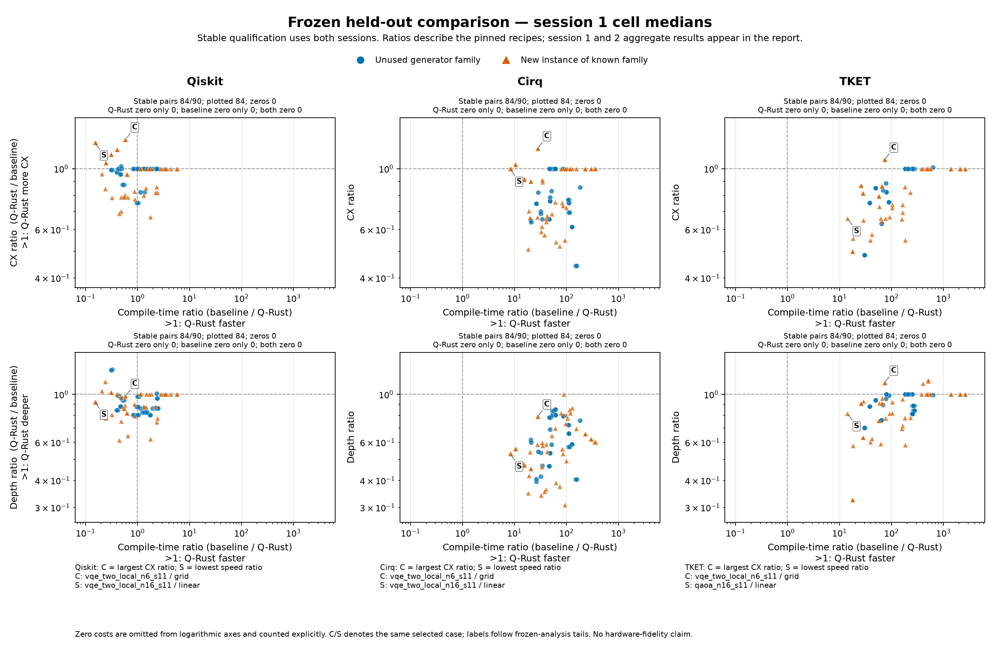

# Frozen compiler study: held-out results and routing diagnostics

This study freezes the existing four compiler recipes and evaluates **30 new MQT Bench instances across 90 circuit–target cases**, alongside controlled investigations of the existing Cat/GHZ and dense-Clifford gaps. No production compiler, dependency, recipe or correctness oracle was changed. The held-out results describe the pinned configurations and selected corpus.

## Frozen configuration and scope

Q-Rust timed compiler source: `3306937c0ae71fb2eb78ad86141f2ccd1b636465`; repository snapshot: `3327d6cdcd937f3a3786c756a0279cf99e522239`. Native binary SHA-256: `aa6513a05aa814b8b89cf373472cacaef4a0afa7c66a296d76a67ef4f4824e1e`. The archive includes the frozen Python harness, package versions and installed-file hashes, generator sources, input hashes, schedules and results; installed package payloads remain environment dependencies.

| Tool | Pinned version / recipe |
|---|---|
| Q-Rust | Public O3 pipeline, U/CX basis, deterministic routing |
| Qiskit | 2.5.2; transpile optimization_level=3, exact synthesis, qubits_initially_zero=False |
| Cirq | 1.7.0; CZ synthesis / RouteCQC / CZ synthesis / CX closure, at most two synthesis iterations per phase |
| TKET | 2.18.5; FullPeepholeOptimise / DefaultMappingPass / connectivity-preserving cleanup / U3,CX |

The held-out corpus contains 6 fixed generator families at 6, 10, 16 logical qubits, each on complete, linear and grid connectivity. Grid shapes are 2×3, 2×5 and 4×4; physical width equals logical width. All tools receive the same normalized unitary input and U3/CX target, with free initial/final layouts and ideal bidirectional edges. These are structural costs, not hardware fidelity or calibrated gate durations.

All 30 candidates were prescribed before compiler observations; 30 passed source eligibility and 0 were excluded without replacement. The source ledger retains every exclusion. QUARK copula/cardinality and random-circuit generators form the unused-generator subset; QAOA, arithmetic and variational cases test new instances of familiar coarse families. Parameter seeds produce related instances. Lexical non-overlap is checked; semantic independence and representative sampling are not established.

The generators come from [MQT Bench at the pinned revision `2cd3f3b`](https://github.com/munich-quantum-toolkit/bench/tree/2cd3f3b08d5d8866595948fbce955e701e86a5df/src/mqt/bench/benchmarks). This is a custom held-out comparison using those generators and the frozen common recipes, not execution of the complete native Benchpress workout suite or its leaderboard. The existing Benchpress-derived Cat/GHZ and dense cases are separate development diagnostics.

MQT inputs are generated through pinned Qiskit circuit definitions. Exact definition expansion and the common source normalizer are checked against the independent analytic oracle. This compares the same lowered input across recipes; it does not evaluate each SDK’s best native high-level pipeline or establish full independence from the generating front end. The retained `sxdg` input-dialect boundary illustrates this distinction.

Each of two sequential sessions uses one initial warmup and 5 timed trials per case/tool: 3,600 prescribed timed slots and 720 initial warmups, plus any recorded restart warmups. Fresh persistent workers are used per session. Qiskit receives the same five trial seeds in both sessions; Cirq, TKET and Q-Rust do not consume those seeds in these recipes. Parsing, compilation and complete request time are recorded separately. No diagnostic jobs or validators run concurrently with timing.

Every timed output and initial/replacement warmup is checked after both sessions. The unchanged analytic oracle uses full numerical unitary/isometry comparison at six qubits and eight fixed input states at ten/sixteen qubits, one shared global phase, a 1e-7 residual threshold and explicit basis/edge/layout checks. The larger general-circuit checks are sampled evidence, not proof. Eligibility requires every prescribed trial and warmup to pass; failures are never replaced with a successful subset.

## Coverage and retained failures

| Tool | Eligible S1 | Eligible S2 | Stable across both | Timed outcomes S1 | Timed outcomes S2 |
|---|---|---|---|---|---|
| Q-Rust | 84 | 84 | 84 | error: 30; verified: 420 | error: 30; verified: 420 |
| Qiskit | 90 | 90 | 90 | verified: 450 | verified: 450 |
| Cirq | 90 | 90 | 90 | verified: 450 | verified: 450 |
| TKET | 90 | 90 | 90 | verified: 450 | verified: 450 |

The stable four-tool common cohort contains **84/90 cases**. Pairwise comparisons below use their own stable paired cohorts. The [failure ledger](./external_results/20261018_frozen_heldout/failure_ledger.json) retains every excluded case/tool/session, failure reason and warmup outcome. Source exclusions and all raw statuses remain in the archive.

**Q-Rust rejects undeclared `sxdg` in 6 distinct circuit–target cases (12 case/session cells).** The frozen normalizer retains primitives supported by its analytic oracle; this vocabulary is broader than the four front ends’ shared input dialect. Qiskit explicitly enables legacy builtin instructions, and the installed Cirq/TKET parsers also recognize `sxdg`; Q-Rust recognizes `sx` but requires a source declaration for the unknown `sxdg` spelling. This is a pipeline/input-dialect interoperability gap, not evidence of wrong quantum mathematics or an OpenQASM 2.0 standards violation. These rejected cells remain failures and contribute no Q-Rust speed or quality scores; all paired means are conditional on supported, verified cases. [Exact source provenance](./external_results/20261018_frozen_heldout/input_dialect.md).

Worker RSS is sampled approximately every 100 ms, with 2 GiB per worker and 3 GiB aggregate limits including idle workers. Sampling can overshoot, child processes are not included, and observer work is outside compilation timing. Operating-system load, CPU frequency and affinity are not controlled.

### Cross-session consistency

The following compares **1,800 cross-session paired trial identities** (case, tool, trial), each joining one output or failure from each session. This is not a count of individual outputs. It checks compilation status, validation status, structural metrics and then artifact/map hashes in that order; a matching category does not by itself establish validation eligibility. Any changed quality, status or artifact remains visible. Timing values are not part of this agreement check.

| Tool | Cross-session paired trial identities | Agreement categories |
|---|---|---|
| Q-Rust | 450 | identical_artifact: 420; same_nonsuccess_status: 30 |
| Qiskit | 450 | identical_artifact: 450 |
| Cirq | 450 | identical_artifact: 450 |
| TKET | 450 | identical_artifact: 443; quality_changed: 7 |
| All tools | 1800 | identical_artifact: 1763; quality_changed: 7; same_nonsuccess_status: 30 |

The frozen seed-policy text described the non-Qiskit recipes as deterministic. This was an expected recipe property, not an empirical result. Only Qiskit consumes the requested compiler trial seeds in these adapters; the absence of a consumed seed does not establish repeatable output.

Observed TKET variability: **7 of 450 matched-request/corresponding-trial pairs with both outputs compiled changed structural quality**; 0 additional pairs changed artifact/map hashes with unchanged quality, and 0 pairs changed compilation or validation status. This pairs requests, not a controlled internal RNG seed for that SDK. These observations remain in the separate session tables; their internal cause is not identified by this agreement check.

For TKET, 0 of 90 cells qualified in both sessions changed their median structural metrics. Trial-level variability and stability of cell medians are separate observations.

Every paired compiled artifact/map matches for Q-Rust (420 compiled pairs), Qiskit (450 compiled pairs), Cirq (450 compiled pairs). Matching non-success statuses are counted separately and do not count as successful compilation.

The [TKET variability evidence and pinned-source inspection](./external_results/20261018_frozen_heldout/tket_variability.md), with its [machine-readable companion](./external_results/20261018_frozen_heldout/TKET_VARIABILITY.json), identify the changed requests and distinguish observed output differences from possible mechanisms. A wall-clock placement timeout is a hypothesis, not an isolated cause established by this study.

## Held-out speed and output quality

Each cell uses the median of all five trials. The primary estimate is an equal-case geometric mean over positive paired ratios on cases eligible for both tools in both sessions. Speed is baseline/Q-Rust (>1 favors Q-Rust); quality is Q-Rust/baseline (<1 favors Q-Rust). Brackets give 95% percentile intervals from 2,000 fixture-cluster bootstrap draws, retaining each fixture’s targets together. These intervals describe this fixed corpus, not all quantum workloads.

| Session | Baseline | Paired cases | Compile speed | CX ratio | Depth ratio | Two-qubit-depth ratio |
|---|---|---|---|---|---|---|
| 1 | Qiskit | 84 | 0.965× [0.779, 1.18] | 0.953× [0.919, 0.986] | 0.9× [0.873, 0.926] | 0.971× [0.927, 1.02] |
| 1 | Cirq | 84 | 56.4× [49.1, 64.8] | 0.811× [0.779, 0.849] | 0.594× [0.568, 0.625] | 0.801× [0.758, 0.846] |
| 1 | TKET | 84 | 146× [122, 172] | 0.842× [0.807, 0.882] | 0.854× [0.819, 0.892] | 0.834× [0.789, 0.881] |
| 2 | Qiskit | 84 | 0.961× [0.778, 1.2] | 0.953× [0.92, 0.986] | 0.9× [0.874, 0.927] | 0.971× [0.924, 1.02] |
| 2 | Cirq | 84 | 56.3× [48.8, 64.7] | 0.811× [0.777, 0.849] | 0.594× [0.567, 0.624] | 0.801× [0.761, 0.845] |
| 2 | TKET | 84 | 146× [124, 171] | 0.842× [0.804, 0.881] | 0.854× [0.818, 0.89] | 0.834× [0.788, 0.88] |

### Timing boundary sensitivity

The following uses the frozen analysis’s two existing timing endpoints. Compile-only excludes parsing; parse-plus-compile takes each trial’s sum before the cell median. Both use baseline/Q-Rust ratios, the same stable pairing and the existing fixture-cluster intervals. Complete request-wall duration is retained in raw records but is not an aggregate endpoint in the frozen analysis.

| Session | Baseline | Paired cases | Compile-only speed ratio | Parse-plus-compile speed ratio |
|---|---|---|---|---|
| 1 | Qiskit | 84 | 0.965× [0.779, 1.18] | 1.03× [0.831, 1.26] |
| 1 | Cirq | 84 | 56.4× [49.1, 64.8] | 56.7× [49.3, 65] |
| 1 | TKET | 84 | 146× [122, 172] | 142× [121, 168] |
| 2 | Qiskit | 84 | 0.961× [0.778, 1.2] | 1.02× [0.823, 1.27] |
| 2 | Cirq | 84 | 56.3× [48.8, 64.7] | 56.5× [49.1, 65.5] |
| 2 | TKET | 84 | 146× [124, 171] | 142× [120, 168] |

Against Qiskit, the small point-estimate difference changes direction with the timing boundary in both sessions: Q-Rust is slower for compile-only and faster for parse-plus-compile. This boundary sensitivity does not support a robust speed-advantage claim.

All four Qiskit timing-boundary confidence intervals include parity.

The figure displays session 1 cell medians; the table above retains both sessions. Points use stable paired eligibility, and each panel states its full paired denominator and all zero-cost exclusions. Right of one means Q-Rust compiles faster; above one means it uses more CX or greater depth. Colors/shapes distinguish unused generator families from new instances of known families. C/S annotations use the frozen analysis’s largest-CX and lowest-speed tails. [Vector figure](./external_results/20261018_frozen_heldout/tradeoffs.svg) · [Exact plot data](./external_results/20261018_frozen_heldout/tradeoffs_data.json).

Zero numerator/denominator pairs are excluded from logarithmic ratios and counted explicitly; no pseudocount is used. Win/tie/loss and all zero cases remain in the machine-readable report metrics. There are no zero pairs in the aggregate metrics shown above.

The secondary estimate balances represented generator families rather than individual cases. The family count is explicit because a family absent from an eligible positive-ratio cohort cannot contribute to its geometric mean.

| Session | Baseline | Balanced speed | Balanced CX | Balanced depth | Balanced two-qubit depth |
|---|---|---|---|---|---|
| 1 | Qiskit | 0.951× [0.8, 1.14] (families 6) | 0.955× [0.944, 0.965] (families 6) | 0.913× [0.897, 0.929] (families 6) | 0.97× [0.951, 0.99] (families 6) |
| 1 | Cirq | 59.5× [55.2, 63.9] (families 6) | 0.811× [0.801, 0.821] (families 6) | 0.611× [0.594, 0.626] (families 6) | 0.804× [0.784, 0.822] (families 6) |
| 1 | TKET | 147× [135, 160] (families 6) | 0.845× [0.83, 0.86] (families 6) | 0.875× [0.851, 0.901] (families 6) | 0.842× [0.818, 0.867] (families 6) |
| 2 | Qiskit | 0.942× [0.795, 1.14] (families 6) | 0.955× [0.945, 0.965] (families 6) | 0.913× [0.897, 0.929] (families 6) | 0.97× [0.951, 0.991] (families 6) |
| 2 | Cirq | 59.5× [55.4, 64] (families 6) | 0.811× [0.801, 0.821] (families 6) | 0.611× [0.594, 0.627] (families 6) | 0.804× [0.784, 0.823] (families 6) |
| 2 | TKET | 147× [136, 160] (families 6) | 0.845× [0.831, 0.86] (families 6) | 0.875× [0.851, 0.898] (families 6) | 0.842× [0.818, 0.869] (families 6) |

### Unused generators versus new instances of known families

These strata test two different kinds of transfer. Ratios below use the same stable qualification rule; they are not a new independent sample of compiler behavior. Entries show session 1 / session 2.

| Stratum | Baseline | Cases | Speed S1 / S2 | CX S1 / S2 | Depth S1 / S2 | Two-qubit depth S1 / S2 |
|---|---|---|---|---|---|---|
| new instance known family | Qiskit | 45 | 0.92× / 0.908× | 0.942× / 0.942× | 0.905× / 0.905× | 0.97× / 0.97× |
| new instance known family | Cirq | 45 | 53.1× / 53.2× | 0.831× / 0.831× | 0.566× / 0.566× | 0.802× / 0.802× |
| new instance known family | TKET | 45 | 142× / 142× | 0.802× / 0.802× | 0.829× / 0.829× | 0.765× / 0.765× |
| untouched generator family | Qiskit | 39 | 1.02× / 1.02× | 0.965× / 0.965× | 0.894× / 0.894× | 0.973× / 0.973× |
| untouched generator family | Cirq | 39 | 60.4× / 60.1× | 0.789× / 0.789× | 0.629× / 0.629× | 0.8× / 0.8× |
| untouched generator family | TKET | 39 | 150× / 150× | 0.891× / 0.891× | 0.884× / 0.884× | 0.922× / 0.922× |

### Important adverse tails

The following are the weakest Q-Rust speed/CX/depth comparisons selected mechanically from the stable cohort in session 1. A speed ratio above one can still be the weakest observed speed result; it is not labeled a loss. Full tails for both sessions and separate family/width/target summaries are retained in the analysis.

| Baseline | Selection | Case | Speed ratio | CX Q-Rust / baseline | Depth Q-Rust / baseline |
|---|---|---|---|---|---|
| Qiskit | lowest speed ratio | vqe_two_local_n16_s11 / linear | 0.151× | 1010 / 812 | 277 / 300 |
| Qiskit | largest CX ratio | vqe_two_local_n6_s11 / grid | 0.59× | 83 / 65 | 60 / 61 |
| Qiskit | largest depth ratio | bmw_quark_copula_n16_s11 / linear | 0.327× | 495 / 500 | 289 / 222 |
| Cirq | lowest speed ratio | vqe_two_local_n16_s11 / linear | 8.25× | 1010 / 1012 | 277 / 521 |
| Cirq | largest CX ratio | vqe_two_local_n6_s11 / grid | 27.9× | 83 / 70 | 60 / 76 |
| Cirq | largest depth ratio | draper_qft_adder_n6 / all_to_all | 89.2× | 21 / 21 | 37 / 37 |
| TKET | lowest speed ratio | qaoa_n16_s11 / linear | 14.3× | 703 / 1066 | 379 / 464 |
| TKET | largest CX ratio | vqe_two_local_n6_s11 / grid | 73.9× | 83 / 77 | 60 / 53 |
| TKET | largest depth ratio | draper_qft_adder_n16 / all_to_all | 505× | 176 / 176 | 137 / 118 |

## Cat/GHZ: why the CX gap occurs

The four development inputs are H plus a CX chain. Each target contains a path that realizes the complete unitary with no routing SWAP. Qiskit’s default trace uses VF2Layout; Cirq’s LineInitialMapper and TKET’s GraphPlacement likewise find zero-SWAP paths. Q-Rust’s default initial layouts miss that opportunity.

| Case | Input CX | Q-Rust SWAPs | CX after lowering | Final Q-Rust CX | Path-relabel CX | Qiskit / Cirq / TKET CX |
|---|---|---|---|---|---|---|
| cat22_square | 21 | 3 | 30 | 28 | 21 | 21 / 21 / 21 |
| cat22_heavy-hex | 21 | 10 | 51 | 51 | 21 | 21 / 21 / 21 |
| ghz23_square | 22 | 5 | 37 | 33 | 22 | 22 / 22 / 22 |
| ghz23_heavy-hex | 22 | 10 | 52 | 52 | 22 | 22 / 22 / 22 |

Relabeling only the physical graph around a witnessed path lets the unchanged Q-Rust binary attain 21/22 CX. Outputs/maps are restored to original physical labels before all-input Clifford isometry checks. This demonstrates heuristic label sensitivity and attainable zero-SWAP placement, not a fixed-layout API. Disabling Clifford simplification, block synthesis, or both leaves the default final costs unchanged. Forty layout trials change only GHZ-heavy-hex, 52→50 CX; six layout iterations change none.

For these four cases, n−1 CX is a proven lower bound under the unitary one-qubit/CX contract: the product-zero input must become an n-output GHZ state, requiring a connected interaction component. The independently checked path witness also implements the full input unitary and attains that bound. This limited optimum claim does not extend to the remaining benchmarks.

Qiskit optimization-stage omission and TKET pre/post-cleanup omissions preserve their minimal counts. TKET identity placement introduces substantial verified routing overhead, while fixed path placement restores the minimum. Cirq’s default CZ synthesis round trip preserves optimal CX but produces depth 43/45; omitting both synthesis stages preserves correctness and yields depth 22/23. This is a cost of the chosen Cirq recipe, not its best possible configuration.

Cat/GHZ evidence: 112 verified compiler interventions plus 4 verified witnesses; 10 unsupported compiled controls and 2 retained errors. 12 SDK trace/native pairs match exactly; 348 qualified phase/map/edge negative controls are rejected. Unsupported local decompositions are not labeled incorrect. [Full Cat/GHZ evidence and limitations](./external_results/20261018_frozen_heldout/cat_ghz_findings.md).

## Dense Clifford20: where compilation time goes

These controlled tests use one existing 20-logical-qubit development circuit on two larger physical graphs. Their instrumented durations are diagnostic and separate from held-out speed measurements. Per-request stage groups are summed first, divided by that request’s total, and then summarized; separately computed stage medians are not added into a false total.

| Target | Unprofiled compile median | Beam-routing share | Layout-search share | CX / depth / two-qubit depth |
|---|---|---|---|---|
| clifford20_heavy-hex | 18.2 s | 89.9% | 3.43% | 7898 / 3612 / 3138 |
| clifford20_square | 6.86 s | 83.7% | 6.43% | 4416 / 2464 / 2017 |

The dominant work is beam routing. The frozen O3 routine repeatedly searches forward and backward with multiple active candidate states. The frozen pipeline routes two distinct prepared Clifford continuations before applying its final-output quality guard. Source inspection also identifies state copying, candidate scoring/ranking and retained alternatives; allocation-level contributions are not separately measured. Distances are precomputed per route, so repeated shortest-path search for every candidate is not the explanation.

### Controlled Q-Rust changes

Each row below is a verified diagnostic intervention, not a production update. Speed ratios compare its profiled median with the profiled default recorded in the same diagnostic campaign. Quality columns show intervention minus default; positive values are worse.

| Target | Intervention | Diagnostic speed ratio | Δ CX | Δ depth | Δ two-qubit depth |
|---|---|---|---|---|---|
| clifford20_heavy-hex | qrust_layout_1x1 | 1.12× | +178 | +61 | +83 |
| clifford20_heavy-hex | qrust_lookahead_5 | 1.06× | -111 | -214 | -181 |
| clifford20_heavy-hex | qrust_no_blocks | 1× | +61 | +21 | +14 |
| clifford20_heavy-hex | qrust_no_clifford | 2.08× | +0 | +0 | +0 |
| clifford20_heavy-hex | qrust_no_rank_progress | 2× | -234 | -360 | -260 |
| clifford20_square | qrust_layout_1x1 | 1.09× | +47 | -6 | -7 |
| clifford20_square | qrust_lookahead_5 | 1.02× | +203 | +121 | +118 |
| clifford20_square | qrust_no_blocks | 1.05× | +35 | +12 | +22 |
| clifford20_square | qrust_no_clifford | 2.02× | +75 | +331 | +206 |
| clifford20_square | qrust_no_rank_progress | 1.95× | +222 | -141 | -113 |

### SDK controls on the same dense input

Only complete independently verified diagnostic cells are shown with quality and compilation medians. Native entries use the unchanged adapters; instrumented entries include callback/stage-probe work and are labeled separately. These durations are diagnostic, not native comparative speed estimates. Recipe omissions alter optimization effort; they are not equal-budget searches. Every unsupported output, timeout and error is retained below and in the full diagnostic notes. The SDK v2 protocol replaced a statically inapplicable native-CX arm with one-pass Cirq synthesis before any SDK execution; the original unexecuted protocol and revision rationale are preserved.

| Target | Recipe | Timing kind | Diagnostic compile median | CX | Depth | Two-qubit depth |
|---|---|---|---|---|---|---|
| clifford20_heavy-hex | tket_light | instrumented | 3.55 s | 13256 | 5427 | 5021 |
| clifford20_heavy-hex | tket_original | native | 23.2 s | 8723 | 3478 | 3248 |
| clifford20_heavy-hex | tket_profiled | instrumented | 22.8 s | 8723 | 3478 | 3248 |
| clifford20_square | tket_light | instrumented | 3.09 s | 7870 | 3566 | 3152 |
| clifford20_square | tket_original | native | 22.3 s | 4813 | 2271 | 2025 |
| clifford20_square | tket_profiled | instrumented | 22.5 s | 4813 | 2271 | 2025 |

| Track | Target | Recipe | Unqualified outcomes |
|---|---|---|---|
| sdk_ablation_v2 | clifford20_heavy-hex | cirq_frozen | timeout: 4 |
| sdk_ablation_v2 | clifford20_heavy-hex | cirq_one_pass | unverified_output: 4 |
| sdk_ablation_v2 | clifford20_heavy-hex | cirq_original | timeout: 4 |
| sdk_ablation_v2 | clifford20_heavy-hex | qiskit_original | unverified_output: 4 |
| sdk_ablation_v2 | clifford20_heavy-hex | qiskit_profiled | unverified_output: 4 |
| sdk_ablation_v2 | clifford20_square | cirq_frozen | unverified_output: 4 |
| sdk_ablation_v2 | clifford20_square | cirq_one_pass | unverified_output: 4 |
| sdk_ablation_v2 | clifford20_square | cirq_original | unverified_output: 4 |
| sdk_ablation_v2 | clifford20_square | qiskit_original | unverified_output: 4 |
| sdk_ablation_v2 | clifford20_square | qiskit_profiled | unverified_output: 4 |

The [full dense investigation](./external_results/20261018_frozen_heldout/dense_findings.md) and [pinned source details](./external_results/20261018_frozen_heldout/dense_source_notes.md) retain pass specifications, per-request traces, alternate-candidate selection evidence and remaining causal limits. The causal records are bound in the archive; unsupported local-Clifford decompositions do not establish semantic failure.

## What this study establishes and what remains open

The Cat/GHZ controls isolate an available placement improvement and explain the competitors’ minimal CX. The dense controls locate the dominant runtime and test selected search/optimization trade-offs. The held-out run tests transfer to new inputs without changing the frozen compilers or selecting replacements from their outcomes.

This does not establish the best possible settings of each SDK, equal optimization effort, language-level causality, optimality outside the witnessed Cat/GHZ cases, calibrated hardware fidelity or comprehensive state-of-the-art coverage. Larger non-Clifford checks remain sampled, related generator instances are not independent families, and two sessions of warm-process timing on one host do not characterize all platforms. Diagnostics explain tested mechanisms; they do not attribute every remaining score to a unique internal cause.

## Reproducibility and preservation

[Evidence archive](./external_results/20261018_frozen_heldout/evidence.tar.gz), [checksums](./external_results/20261018_frozen_heldout/checksums.json), [report metrics](./external_results/20261018_frozen_heldout/report_metrics.json) and [failure ledger](./external_results/20261018_frozen_heldout/failure_ledger.json). The archive retains frozen generator/recipe/source hashes, original inputs, schedules, raw outcomes, warmups, errors, validation, analysis and diagnostic interventions. Historical results remain unchanged in their earlier versioned directories and are checked against the preservation manifest.

After fresh extraction, use the supplied replay helpers to validate saved outputs and rederive summaries in the pinned environment. They do not rerun compilers. Every compiler/parse/request/pass measurement and verdict/map must remain identical; only an explicitly identified fresh verifier duration and its independently checked derived hash may differ. Exact installed-file hashes are more restrictive than version numbers, and the native binary remains specific to its original host architecture. Archive audit/replay completion is documented in the separate receipts, not inferred from the report generator.
