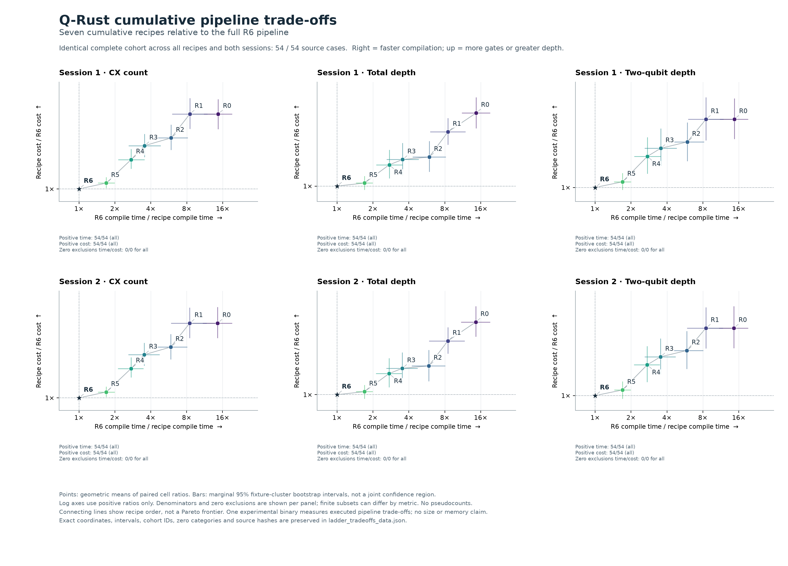

# Frozen reduced-pipeline study

This study tests seven cumulative Q-Rust configurations on **18 fresh MQT Bench instances and 54 circuit–target cases**, with the unchanged Qiskit, Cirq and TKET recipes as context. All 5,400 timed outputs and 1,080 warmups pass the prescribed independent checks. All 54 cases qualify for every configuration in both sessions; no failed cases disappear from the comparisons.

The reduced baseline R0 pipeline is 14.5–14.7× faster than full R6, with geometric-mean overheads of 42.1% CX, 59.9% total depth and 48.4% two-qubit depth. R5 retains the optimization groups and placement search but uses a smaller routing search: it is 1.69× faster, with 2.8%, 2.0% and 3.3% overhead, respectively. R5 stays within 5% on all three structural metrics in 39/54 cases and within 10% in 41/54. The adverse tail is substantial: QFT-entangled-14 on a line has depth 307 under R5 versus 165 under R6.

These observations support a bounded trade-off between routing effort and output quality. They do not support removing most optimization groups without material cost. The experiment changes which groups execute in one experimental binary; it does not measure reduced source size, executable size, memory use or a Rust-specific language effect. Production compiler code and defaults remain unchanged.

## Frozen implementation and cumulative groups

The public repository baseline is `105587df2425cac5a6a859c65e99b86d0cc89d2a`; the reference binary was built from compiler source commit `3306937c0ae71fb2eb78ad86141f2ccd1b636465`. An isolated source copy supplies explicit R0–R6 selectors. Its pass algorithms, numerical policy, validation, layout bookkeeping, readout restoration and applicable candidate-acceptance safeguards remain unchanged. Recipes enable groups in their original positions rather than appending them to the end.

| Recipe | Newly enabled behavior |
| --- | --- |
| R0 | Mandatory input/custom/high-arity lowering, basic routing, target/basis decomposition with KAK fallback, direction repair, basis closure, maps, numerical ledger and readout handling. Identity placement; per-route beam/branch/bidirectional budget 1/1/1. |
| R1 | Gate crystallization and parameter cleanup; postlower one-qubit fusion and parameter simplification. |
| R2 | Phase-gadget recovery, rotation merging, cross-conjugation, inverse/commutation cancellation and related cleanup; diagonal routing-dependency commutation. |
| R3 | Two-qubit block synthesis and dependent checked post-block fusion. |
| R4 | Encoded-SWAP and Clifford transformations, logical/output permutations, trailing SWAP elision, SWAP orientation and cleanup; the original applicable retained-input/Clifford continuations. |
| R5 | Original SABRE placement search: ten trials and three forward/backward refinements, with its bounded refined-placement candidate handling. |
| R6 | Raise only the per-route beam/branch/bidirectional budget from 1/1/1 to full O3 8/5/4. |

All recipes retain lookahead 20, scoring weight 0.5, progress ranking and routing-candidate retention. R0–R4 begin with identity placement and are label-sensitive; R0 is not claimed to be the best inexpensive recipe. Inactive semantic flags are disabled before their group. R4 can create retained continuations and R5 can add placement alternatives, so a fixed per-route budget does not imply equal total work.

The strict experiment adapter rejects unknown or conflicting controls and records effective options plus actual registered pass names. Every formal Q-Rust response is checked against the frozen expected metadata. Routing-reuse context includes the selected recipe. Development controls compare the full R6 and unchanged copied path against the original binary in both profiling modes: all 104 exact output/report/trace comparisons pass in each development attempt. This establishes development behavioral parity, not runtime equality between the experimental and original binaries.

The experiment-specific Rust tests cover recipe membership, mandatory lowering, numerical accumulation, custom gates, barriers, measurements/maps, directed connectivity and invalid controls. The copied workspace test run passes 502 tests with four ignored; the final adapter revision passes its four dedicated regressions and release build. Separate synthetic tests cover the harness, source checks, method audit, plots, variability and archive/replay contracts. Test logs and unsuccessful diagnostic attempts are retained.

## Inputs, targets and holdout limits

The six pinned generators are `bmw_quark_copula`, `bmw_quark_cardinality`, `qaoa`, `vqe_two_local`, `graphstate` and `qftentangled`, each at 6, 10 and 14 qubits. Parameter binding uses seed 53 for the first four; QAOA also uses graph seed 53. Graph-state construction uses degree 3 and seed 53. QFT-entangled uses its fixed constructor once per width, without duplicate nominal seeds. Sources come from [MQT Bench revision 2cd3f3b](https://github.com/munich-quantum-toolkit/bench/tree/2cd3f3b08d5d8866595948fbce955e701e86a5df/src/mqt/bench/benchmarks), version 2.3.0.

Selection, pipeline groups, metrics and analysis rules were fixed before selected compiler execution. No selected case was replaced or excluded: 18 admitted instances, zero exclusions. Lexical overlap checks against recorded previous input QASM and conservatively unclassified QASM found no collision. The inventory distinguishes 44,168 explicit input records, 655,569 output records and 2,020 unclassified records; these include copies, not that many unique circuits. Output artifacts are not treated as previous benchmark inputs. Lexical freshness does not establish semantic independence. In particular, graphstate and qftentangled are unused generator implementations within familiar coarse families; these are not six entirely new algorithm families or a representative population sample.

Every instance runs on complete, bidirectional linear and rectangular-grid targets (2×3, 2×5 and 2×7). Physical width equals logical width. All recipes receive the same normalized circuit, U3/CX output basis and ideal graph contract, with free initial/final qubit maps. Raw QPY/QASM, canonical forms, normalized input and provenance are preserved. Generators use Qiskit definitions, so this does not compare each tool's best high-level frontend.

A source-preparation revision was required before compiler execution. The initial 14-qubit QFT reference evaluation attempted dense matrix materialization and was stopped; the original raw files, 17 completed normalized pairs and interrupted transcript remain. Version 2 evaluates exact Qiskit gate definitions for the source reference, preserving phase and wire mapping, through a route separate from the common normalizer. Twelve independent controls pass, including small dense-QFT references and wrong-phase/map mutants. All 18 original raw pairs and the 17 earlier completed normalized pairs remain byte-identical. The maximum normalization residual is 2.35e-14. A separate inventory-performance interruption before revised source checking is also retained. Neither preparation revision changes a selected input, compiler, correctness tolerance or benchmark observation.

This is a custom controlled study using community benchmark generators. It is not the complete native Benchpress workout suite, a Benchpress leaderboard result, or a hardware execution benchmark.

## Repeated timing, correctness and analysis

Two sequential sessions use fresh persistent workers, one initial warmup and five timed trials per case/recipe/session. All ten recipes occupy each of the ten timed positions exactly once per case across the two sessions. Case, trial-block and warmup order are seeded. Only Qiskit consumes the requested compiler seeds; no determinism claim is inferred for the other recipes. No validators, traces, builds or other diagnostic jobs run concurrently with timing.

The host is macOS 14.4.1 arm64, with Python 3.12.14 and pinned installed-file hashes. Per-request timeout is 60 seconds; startup timeout is 120 seconds. Sampled RSS guards are 2 GiB per worker and 3 GiB aggregate, including idle workers. These are resource guards, not comparative memory measurements. Both sessions complete without startup failures, timeouts, memory-limit events or replacement warmups.

Compile-only time includes backend/configuration construction, the common experimental configuration clone, compilation and internal acceptance checks. It excludes selector parsing, input parsing, metadata construction, serialization and independent verification. Parse-plus-compile adds recorded input parsing; whole-request times are retained separately. R6's experimental control boundary is not a measurement of native-binary runtime equivalence. SDK recipes are unchanged:

| SDK | Version and recipe |
| --- | --- |
| Qiskit | 2.5.2; optimization level 3, exact synthesis, qubits_initially_zero=False |
| Cirq | 1.7.0; CZ synthesis, RouteCQC, CZ synthesis, CX closure; at most two synthesis iterations per phase |
| TKET | 2.18.5; FullPeepholeOptimise, DefaultMappingPass, connectivity-preserving cleanup, U3/CX closure |

Independent validation runs only after both timing sessions. The unchanged analytic NumPy oracle checks basis, connectivity, maps and semantics up to one shared global phase, at residual tolerance 1e-7. Six-qubit instances receive full numerical isometry checks; 10/14-qubit instances receive eight fixed input checks. The larger checks are sampled evidence, not a proof of equivalence. Cache reuse requires identical source/output/target/layout artifact identities.

| Evidence | Full numerical checks | Sampled checks | Total passed |
| --- | --- | --- | --- |
| Timed outputs | 1,800 | 3,600 | 5,400 |
| Warmups | 360 | 720 | 1,080 |

There are 532 unique checked artifact identities (172 full, 360 sampled); repeated rows are not independent new circuits. Maximum residual is 6.3488762467508525e-12. All 54 cases qualify in every arm and SDK in both sessions. All 2,700 corresponding cross-session trial pairs have identical artifacts and maps; no cell median changes structural quality. This is observed repeatability for these requests, not a universal determinism guarantee.

A cell qualifies only if all five timed trials and required warmups pass. The primary cohort is the same case set eligible for all seven Q-Rust arms in both sessions. All-ten and secondary pairwise cohorts also contain the same 54 cases here. Each comparison uses per-cell medians and paired geometric means, with 2,000 fixture-cluster bootstrap draws that retain each fixture's three targets. Sessions remain separate. Intervals describe fixed-corpus sensitivity, not uncertainty over an unobserved population of circuits or machines. The family-balanced secondary analysis and every prescribed stratum are retained in the machine-readable analysis. Each generator contributes nine cases here, so family-balanced point estimates coincide with equal-case point estimates.

Zero-valued ratios are excluded from log means with explicit zero ledgers, while win/tie/loss and retention counts keep all cases. No primary plotted metric requires a zero exclusion in this run. CX count is an entangling-gate count; total depth and two-qubit depth are structural layer counts, not calibrated duration or fidelity.

## Speed and output quality relative to full R6

Speed ratios above one mean the reduced stage is faster; structural ratios above one mean more gates or depth. Brackets are the prescribed marginal 95% fixture-cluster intervals. Every row uses all 54 cases.

| Session | Recipe | Cases | R6/stage compile | R6/stage parse + compile | Stage/R6 CX | Stage/R6 depth | Stage/R6 2q depth |
| --- | --- | --- | --- | --- | --- | --- | --- |
| 1 | R0 | 54 | 14.7× [11.2, 19] | 12.4× [9.31, 16.4] | 1.42× [1.32, 1.52] | 1.6× [1.45, 1.76] | 1.48× [1.33, 1.67] |
| 1 | R1 | 54 | 8.49× [6.06, 11.8] | 7.77× [5.56, 10.8] | 1.42× [1.33, 1.53] | 1.42× [1.31, 1.54] | 1.48× [1.32, 1.68] |
| 1 | R2 | 54 | 5.92× [4.31, 8.11] | 5.61× [4.1, 7.69] | 1.27× [1.2, 1.35] | 1.21× [1.1, 1.33] | 1.3× [1.17, 1.45] |
| 1 | R3 | 54 | 3.54× [2.61, 4.8] | 3.46× [2.55, 4.65] | 1.22× [1.16, 1.29] | 1.19× [1.07, 1.32] | 1.25× [1.14, 1.4] |
| 1 | R4 | 54 | 2.74× [2.14, 3.52] | 2.7× [2.09, 3.46] | 1.15× [1.1, 1.2] | 1.15× [1.05, 1.26] | 1.2× [1.08, 1.33] |
| 1 | R5 | 54 | 1.69× [1.45, 1.98] | 1.69× [1.44, 1.99] | 1.03× [1.01, 1.06] | 1.02× [0.978, 1.06] | 1.03× [0.988, 1.08] |
| 1 | R6 | 54 | 1× [1, 1] | 1× [1, 1] | 1× [1, 1] | 1× [1, 1] | 1× [1, 1] |
| 2 | R0 | 54 | 14.5× [11, 19.1] | 12.3× [9.24, 16.2] | 1.42× [1.33, 1.53] | 1.6× [1.46, 1.77] | 1.48× [1.32, 1.68] |
| 2 | R1 | 54 | 8.49× [5.94, 11.7] | 7.76× [5.55, 10.6] | 1.42× [1.33, 1.53] | 1.42× [1.31, 1.54] | 1.48× [1.32, 1.67] |
| 2 | R2 | 54 | 5.88× [4.26, 8.02] | 5.57× [4, 7.65] | 1.27× [1.2, 1.35] | 1.21× [1.09, 1.33] | 1.3× [1.17, 1.46] |
| 2 | R3 | 54 | 3.53× [2.61, 4.7] | 3.44× [2.57, 4.63] | 1.22× [1.17, 1.29] | 1.19× [1.08, 1.31] | 1.25× [1.13, 1.39] |
| 2 | R4 | 54 | 2.73× [2.13, 3.46] | 2.7× [2.11, 3.4] | 1.15× [1.1, 1.21] | 1.15× [1.05, 1.26] | 1.2× [1.09, 1.33] |
| 2 | R5 | 54 | 1.69× [1.45, 1.98] | 1.69× [1.44, 1.96] | 1.03× [1.01, 1.05] | 1.02× [0.976, 1.06] | 1.03× [0.983, 1.08] |
| 2 | R6 | 54 | 1× [1, 1] | 1× [1, 1] | 1× [1, 1] | 1× [1, 1] | 1× [1, 1] |

The figure uses the same cohort in every panel and reports marginal intervals, not joint confidence regions. R0–R6 are all reported; no stage is selected after inspection and presented as a newly validated default.

## What adding each group changes

The adjacent comparisons measure a group conditional on all preceding groups and the frozen ordering. R2 changes both circuit rewrites and routing dependencies; R4 combines representation changes with applicable quality continuations. These controls cannot assign the entire group effect to one constituent pass or cover interactions with every alternative ordering.

| Session | Added group | Cases | Previous/new compile | New/previous CX | New/previous depth | New/previous 2q depth |
| --- | --- | --- | --- | --- | --- | --- |
| 1 | R1_vs_R0 | 54 | 0.58× [0.517, 0.641] | 1× [1, 1] | 0.886× [0.837, 0.939] | 1× [1, 1] |
| 1 | R2_vs_R1 | 54 | 0.696× [0.657, 0.737] | 0.894× [0.869, 0.917] | 0.851× [0.807, 0.898] | 0.877× [0.835, 0.917] |
| 1 | R3_vs_R2 | 54 | 0.599× [0.526, 0.678] | 0.965× [0.948, 0.979] | 0.984× [0.973, 0.993] | 0.963× [0.944, 0.979] |
| 1 | R4_vs_R3 | 54 | 0.773× [0.682, 0.867] | 0.937× [0.899, 0.972] | 0.967× [0.944, 0.986] | 0.955× [0.922, 0.983] |
| 1 | R5_vs_R4 | 54 | 0.619× [0.538, 0.707] | 0.896× [0.852, 0.93] | 0.889× [0.815, 0.953] | 0.863× [0.783, 0.932] |
| 1 | R6_vs_R5 | 54 | 0.59× [0.5, 0.69] | 0.973× [0.949, 0.993] | 0.981× [0.94, 1.02] | 0.968× [0.921, 1.02] |
| 2 | R1_vs_R0 | 54 | 0.584× [0.523, 0.65] | 1× [1, 1] | 0.886× [0.834, 0.939] | 1× [1, 1] |
| 2 | R2_vs_R1 | 54 | 0.693× [0.65, 0.734] | 0.894× [0.868, 0.918] | 0.851× [0.808, 0.896] | 0.877× [0.835, 0.917] |
| 2 | R3_vs_R2 | 54 | 0.6× [0.527, 0.678] | 0.965× [0.947, 0.979] | 0.984× [0.973, 0.993] | 0.963× [0.945, 0.979] |
| 2 | R4_vs_R3 | 54 | 0.775× [0.685, 0.869] | 0.937× [0.896, 0.973] | 0.967× [0.945, 0.986] | 0.955× [0.921, 0.982] |
| 2 | R5_vs_R4 | 54 | 0.62× [0.543, 0.708] | 0.896× [0.853, 0.929] | 0.889× [0.813, 0.95] | 0.863× [0.779, 0.933] |
| 2 | R6_vs_R5 | 54 | 0.59× [0.499, 0.689] | 0.973× [0.949, 0.993] | 0.981× [0.942, 1.02] | 0.968× [0.919, 1.01] |

R1 leaves CX and two-qubit depth unchanged on all 54 cases but reduces geometric-mean total depth by 11.4%. R2 reduces CX by 10.6%, R3 by 3.5% and R4 by 6.3% relative to the preceding stage. Placement in R5 reduces CX by 10.4%, while wider routing search in R6 reduces it by a further 2.7%. Each added group increases aggregate compile time here; the quality reductions are meaningful, uneven and not monotonic on individual circuits.

Topology explains a large part of the aggregate pattern. On the 18 complete-graph cases, R0 has only 2.7% more CX but 25.8% more depth than R6. On the grid and line, its CX overhead rises to 71.1% and 63.2%. Thus unconstrained CX counts alone would conceal much of the reduced pipeline's cost.

Adding placement (R4→R5) leaves complete-graph structural costs unchanged. On the grid it reduces geometric-mean CX/depth/two-qubit depth by 18.4%/19.5%/23.2%; on the line by 11.9%/12.6%/16.3%, at roughly twice the per-cell compile time on those routed subsets. These are the combined consequences of enabling the frozen placement group and its candidate handling.

R5 and R6 have identical structural costs on all 18 complete-graph cases, with only about 1.01× speed ratio. R5's speed advantage comes from routed targets: approximately 1.89× on grids and 2.53× on lines. Its corresponding line CX/depth/two-qubit-depth ratios are 1.054/1.063/1.076. These observed topology effects do not establish a universally best search budget.

## Case-level retention and adverse outcomes

A case is within a bound only when its median cost does not exceed R6 by that fraction. "All three" means CX, total depth and two-qubit depth must each satisfy the bound. For a zero reference cost, the candidate must also be zero. Counts below are identical in both sessions; the full separate-session, per-metric 0%/5%/10% table is retained in [quality_retention.csv](./external_results/20261019_reduced_pipeline/quality_retention.csv).

| Recipe | Cases | No worse on all three | All three within 5% | All three within 10% | CX within 5% | Depth within 5% | 2q depth within 5% |
| --- | --- | --- | --- | --- | --- | --- | --- |
| R0 | 54 | 6 | 6 | 6 | 18 | 8 | 20 |
| R1 | 54 | 9 | 9 | 9 | 18 | 13 | 20 |
| R2 | 54 | 18 | 18 | 19 | 18 | 25 | 24 |
| R3 | 54 | 18 | 19 | 21 | 20 | 26 | 24 |
| R4 | 54 | 23 | 25 | 27 | 26 | 30 | 29 |
| R5 | 54 | 35 | 39 | 41 | 41 | 43 | 40 |
| R6 | 54 | 54 | 54 | 54 | 54 | 54 | 54 |

R5 is no worse on all three metrics in 35/54 cases (64.8%), within 5% in 39/54 (72.2%) and within 10% in 41/54 (75.9%). All 18 complete-graph cases tie; among only the 36 routed cases, these counts are 17/36, 21/36 and 23/36. Its small mean overhead therefore does not imply a small overhead on every circuit. R0 is jointly within 10% in only 6/54 cases.

| Case | R5 CX / depth / 2q depth | R6 CX / depth / 2q depth | Interpretation |
| --- | --- | --- | --- |
| VQE two-local 6, line | 144 / 102 / 95 | 101 / 77 / 58 | R5's largest CX overhead: 42.6%. |
| QFT-entangled 14, line | 386 / 307 / 186 | 281 / 165 / 89 | R5's largest depth and 2q-depth overheads: 86.1% and 109.0%. |
| Copula 14, grid | 259 / 127 / 98 | 263 / 209 / 152 | Wider search worsens every structural metric. |
| VQE two-local 14, line | 645 / 208 / 170 | 726 / 232 / 224 | Wider search also worsens every structural metric here. |

On QFT-entangled-14/line, R5/R6 compile medians are 35.19/90.49 ms in session 1 and 35.42/90.82 ms in session 2. On VQE-14/line they are 20.91/242.88 ms and 20.87/243.90 ms: more search time does not guarantee a better final circuit.

Relative to R5, R6 increases CX on seven cases, depth on eight and two-qubit depth on nine; ten distinct cases worsen at least one metric. The full adverse-case list and all adjacent outcomes are retained in [stage_interpretation.json](./external_results/20261019_reduced_pipeline/stage_interpretation.json). The intervention establishes the conditional budget effect; it does not isolate the particular internal route/ranking decision behind each adverse result. No fix or retuning is mixed into this frozen evaluation.

The frozen implementation permits such regressions: beam routing ranks and prunes heuristic states, changes initial layouts during reverse search and chooses routes using routing SWAP cost. R6 does not retain an independent completed R5 result as a fallback. Candidate-quality guards compare alternatives within the current recipe rather than against the preceding ladder stage. Likewise, two-qubit synthesis accepts local CX reductions without promising lower global depth. These source properties explain the absence of a monotonic guarantee; they are not a measured trace of each adverse circuit.

## Unchanged SDK context

These comparisons anchor full R6 against the three frozen SDK recipes. They are not equal-search-budget comparisons or claims about every available SDK setting. R5 is not separately tuned against the SDKs.

| Session | SDK | Cases | SDK/R6 compile | SDK/R6 parse + compile | R6/SDK CX | R6/SDK depth | R6/SDK 2q depth |
| --- | --- | --- | --- | --- | --- | --- | --- |
| 1 | cirq | 54 | 55.2× [46.7, 65.3] | 56.2× [47.8, 66] | 0.749× [0.696, 0.809] | 0.504× [0.429, 0.577] | 0.652× [0.536, 0.768] |
| 1 | qiskit | 54 | 1.07× [0.8, 1.44] | 1.14× [0.854, 1.54] | 0.946× [0.906, 0.985] | 0.888× [0.838, 0.938] | 0.929× [0.84, 1.02] |
| 1 | tket | 54 | 150× [123, 183] | 147× [123, 179] | 0.832× [0.788, 0.881] | 0.879× [0.812, 0.947] | 0.814× [0.742, 0.888] |
| 2 | cirq | 54 | 55.2× [46.2, 65.6] | 56.3× [47.9, 66.1] | 0.749× [0.697, 0.807] | 0.504× [0.437, 0.581] | 0.652× [0.541, 0.772] |
| 2 | qiskit | 54 | 1.11× [0.821, 1.51] | 1.18× [0.869, 1.62] | 0.946× [0.905, 0.984] | 0.888× [0.837, 0.94] | 0.929× [0.843, 1.02] |
| 2 | tket | 54 | 152× [125, 184] | 148× [123, 181] | 0.832× [0.786, 0.879] | 0.879× [0.814, 0.949] | 0.814× [0.744, 0.885] |

R6's compile point estimates are 1.07× and 1.11× faster than Qiskit, but both intervals include parity. Parse-plus-compile ratios also include parity. There is no robust Qiskit speed advantage established here; on QFT-entangled-14/line, R6 is approximately 6.2× slower. The selected Cirq and TKET recipes take approximately 55× and 150–152× as long as R6 for warm compilation on this corpus. The corresponding geometric-mean R6 CX ratios are 0.749 and 0.832, versus 0.946 for Qiskit. These aggregate advantages coexist with individual adverse cases in the complete cell tables.

## Preserved attempts, replay and limits

All 1,956 historical evidence files are checked unchanged. The complete new evidence retains frozen input selection, source-preparation revisions, experiment-only source and binary, exact recipes, schedules, raw timings, output circuits/maps, warmups, all diagnostics, independent validation, analyses, tests and report/plot helpers.

The first development check used a spare physical wire and produced 144 independent passes, 144 output-width contract failures and 24 barrier-parser unsupported outcomes, while all 104 parity comparisons passed. The corrected development contract uses physical width equal to logical width, as prescribed for the held-out study: 288 independent passes, 24 retained barrier-parser unsupported outcomes and 104 parity passes. The original compiler shares the output-width behavior. No failed artifact was padded or relabeled as verified; the earlier mistaken failure-count description is corrected in a retained ledger. Separate Rust barrier tests do not replace an unsupported independent-check verdict.

Read the [evidence and replay instructions](./external_results/20261019_reduced_pipeline/README.md), [analysis](./external_results/20261019_reduced_pipeline/ladder_analysis.json), [flat comparison tables](./external_results/20261019_reduced_pipeline/comparisons.csv), and [verification summary](./external_results/20261019_reduced_pipeline/verification_summary.json). Replaying saved outputs does not re-execute compilers. Strict replay requires byte-identical installed dependencies, not merely matching version strings; the archived native binary is host-specific.

The scope remains 18 instances, one parameter binding per selected generator/width, widths 6–14, three ideal graph families, a common normalized input language and selected compiler recipes on one host. Sampled larger-circuit checking, correlated generator structure and fixed ordering limit generalization. This study does not establish optimality, hardware fidelity, universal superiority, equal search effort or that most optimizations are unnecessary. It identifies a measurable search-budget trade-off and exposes where reducing effort has unacceptable structural costs.

